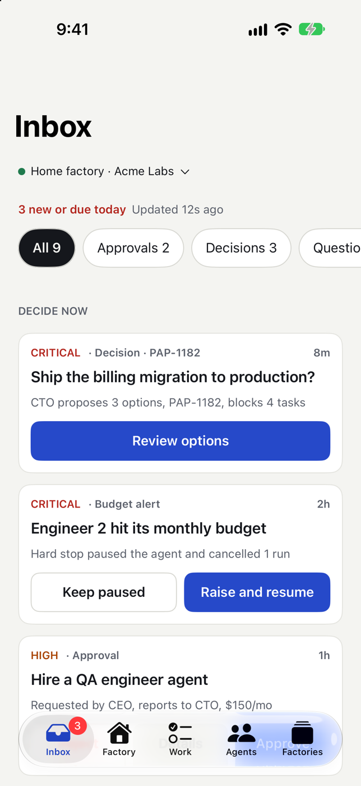
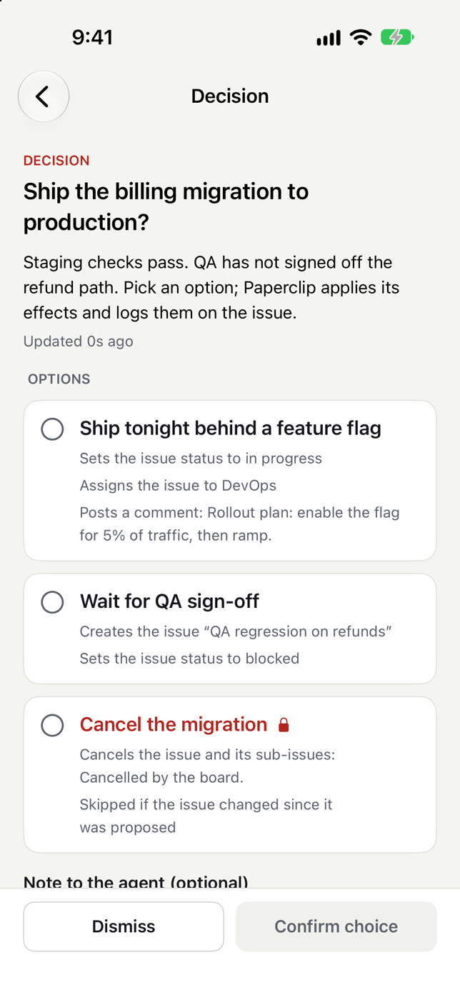
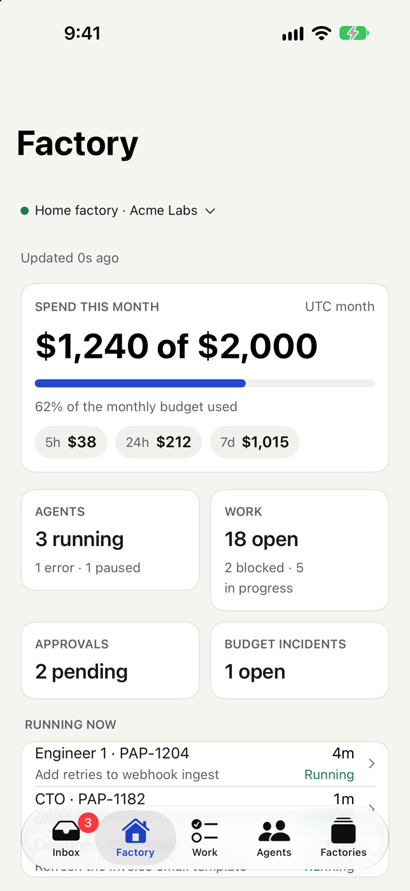
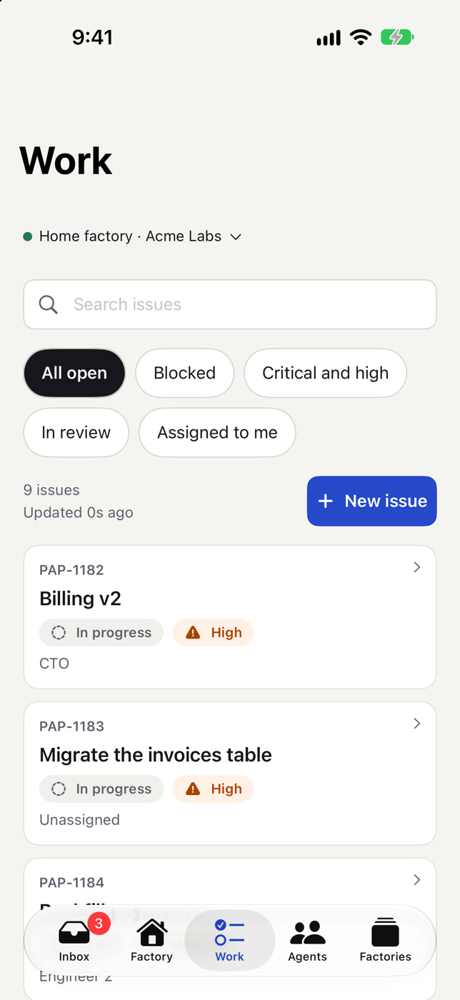

# Paperclip Agent Factory Mobile

Native iPhone and Android apps for deciding, monitoring and intervening in one or more [Paperclip](https://docs.paperclip.ing) AI-agent instances from anywhere, through the Paperclip REST API. All non-UI code is one shared Kotlin Multiplatform core; the iPhone UI is SwiftUI and the Android UI will be Jetpack Compose.

**Status:** the shared Kotlin core (Phase 1a) and the iPhone app (Phase 2i, branch `feat/phase-2i-iphone-ui`) are built. The iPhone app runs on the **real Paperclip adapters** (Phase 1b, merged: Ktor HTTP, SQLDelight, Keychain, LocalAuthentication) and, in Debug builds with `-demo`, on fakes in **demo mode**. It has every main screen: first run, Inbox, Decision, Approval, Budget incident, Factory home, Agents, Agent detail, Run viewer, Work, Issue, Factories, Manage factories, Edit factory and Settings. A launch without `-demo` opens the real graph (empty database: first run, behind the app lock); if it cannot be opened the app says so and offers Try again, and never falls back to fakes. Not yet verified against a live Paperclip server from the app itself (the contract tests cover the adapters). The Android app is not started. Details: [docs/technical-details.md](./docs/technical-details.md) and [specs/261102-phase-2i-iphone-ui/status.md](./specs/261102-phase-2i-iphone-ui/status.md).

| Inbox | Decision | Factory | Work |
|---|---|---|---|
|  |  |  |  |

All screenshots are taken in demo mode (fake data, never a real factory); the pairing screen is never captured. More in [docs/product-details.md](./docs/product-details.md).

## Documents

| File | What it holds |
|---|---|
| [INTENT.md](./INTENT.md) | Why the product exists and how to make trade-offs |
| [PRD](./paperclip-agent-factory-mobile-PRD.md) | Requirements, screens, release plan |
| [Android PRD](./specs/261104-phase-2a-android-ui/paperclip-agent-factory-android-PRD.md) | Phase 2a: the Android app on the shared core, device services, milestones |
| [AGENTS.md](./AGENTS.md) | How we build: toolchain, TDD, Clean Architecture, security rules |
| [docs/product-summary.md](./docs/product-summary.md) | What the app does, in plain words, and where it stands |
| [docs/product-details.md](./docs/product-details.md) | The 16 screens: state holder, behaviour by role, device authentication, offline; mocks versus built |
| [docs/technical-details.md](./docs/technical-details.md) | Modules, graph API, layering rules, mutation order, refresh policy, errors, tests and coverage, iOS interop, known limitations |
| [docs/architectural-decision-record.md](./docs/architectural-decision-record.md) | ADR-001 to ADR-120 (the numbering is not contiguous): why we chose what we chose |
| [user-docs/README.md](./user-docs/README.md) | Index of the guides below |
| [user-docs/getting-started.md](./user-docs/getting-started.md) | Prerequisites, build, gates, XCFramework, iOS tests, demo graph |
| [user-docs/configuration-reference.md](./user-docs/configuration-reference.md) | Every build and configuration knob and validation rule |
| [user-docs/usage-examples.md](./user-docs/usage-examples.md) | Kotlin and Swift snippets that mirror the repository's tests |
| [user-docs/testing-guide.md](./user-docs/testing-guide.md) | TDD, fakes, contract suites, Konsist, Kover; adding a use case or a screen |
| [user-docs/first-factory.md](./user-docs/first-factory.md) | First run and adding a factory |
| [user-docs/pairing.md](./user-docs/pairing.md), [tailscale-and-hostnames.md](./user-docs/tailscale-and-hostnames.md), [managing-factories.md](./user-docs/managing-factories.md), [app-lock.md](./user-docs/app-lock.md), [key-expiry-and-repairing.md](./user-docs/key-expiry-and-repairing.md), [troubleshooting.md](./user-docs/troubleshooting.md) | End-user guides |
| [specs/archive/261101-phase-1a-shared-contracts/](./specs/archive/261101-phase-1a-shared-contracts/status.md) | The Phase 1a specification, research, notes and status |
| [specs/261101-iphone-app/plan.md](./specs/261101-iphone-app/plan.md) | The iPhone implementation plan |

## Build and run (macOS)

Needs a current Xcode (developed with 27.2), JDK 21 (Gradle finds or downloads it; do not set `JAVA_HOME`), and `brew install swiftlint xcodegen`. Gradle needs the Android SDK: put its path in a git-ignored `local.properties` (`sdk.dir=/Users/you/Library/Android/sdk`). Run one Gradle build at a time. Step by step: [user-docs/getting-started.md](./user-docs/getting-started.md).

```bash
./gradlew spotlessApply              # fix formatting
./gradlew check lint                 # format, static analysis, architecture rules, tests (JVM, Android host, iOS simulator), coverage
./scripts/build-kit.sh               # builds PaperclipKit.xcframework into iosApp/Frameworks (keeps the old one if the build fails)
./scripts/ios-test.sh                # generates the Xcode project, runs the iOS unit and UI tests
open iosApp/iosApp.xcodeproj         # after ./scripts/ios-test.sh, run the "iosApp" scheme on a simulator
```

### Demo graph (the whole core on fakes, no server)

`PaperclipCore.createDemoGraph()` builds the graph on fakes seeded with the design mocks' data (Home factory, Acme Labs, PAP-1182, Engineer 1; ADR-026) and every screen's state holder can be driven from it: `graph.attention`, `graph.work`, `graph.agents`, `graph.runs`, `graph.factory`, `graph.createFactoriesStateHolder()` and the other setup holders, `graph.refresh` for the refresh policy and `graph.lifecycle.setForeground(Bool)` for background and foreground (one call: refresh policy and app lock). `PaperclipCore.createGraph(allowInsecureLocal)` is the same wiring on empty fakes (auto-approving biometrics, a clock that does not move; ADR-037); the iPhone app builds it, finds that live adapters are not wired yet and shows a "not available in this build" screen instead of running it (ADR-114). Kotlin and Swift examples that mirror the tests: [user-docs/usage-examples.md](./user-docs/usage-examples.md). The Swift tests that do this are `DemoGraphInteropTests.swift`.

**Run the iPhone app in demo mode.** After `./scripts/build-kit.sh` and `./scripts/ios-test.sh` (or `xcodegen generate` in `iosApp/`), run the `iosApp` scheme with the launch argument `-demo` (Scheme, Run, Arguments). Other launch arguments (`-demo-tab inbox|factory|work|agents|factories`, `-demo-open decision:dec-1182`, `-demo-offline`, `-demo-first-run`, ...) are listed in `iosApp/Sources/App/Environment/LaunchConfiguration.swift`. The `-demo*` arguments exist in Debug builds only (what CI and the UI tests build); a Release build ignores them. Without `-demo` the app shows "Live factories are not available yet" until Phase 1b is merged; `-demo-first-run` starts the first-run flow on fakes, where "Try the demo factory" switches to the demo graph.

**Gates** (all from the repository root): `./gradlew check lint koverXmlReportCore koverXmlReportPresentation`, `swiftlint --strict`, `xcrun swift-format lint --recursive --strict iosApp/Sources iosApp/Tests iosApp/Packages/PaperclipKit/Package.swift`, `./scripts/build-kit.sh`, then `TEST_SET=functional SHARD=1|2|3 ./scripts/ios-test.sh` per shard. The functional shards are blocking and include `LargeTextUITests` (every screen at accessibility XXXL). `TEST_SET=audits ./scripts/ios-test.sh` runs the system accessibility audits; by the owner's decision that job is visible but non-blocking (ADR-119): 16 of its 24 tests fail today and are listed in implementation-notes.md.

### A Paperclip server for contract tests

```bash
./scripts/paperclip-test-server.sh up     # pinned Paperclip in Docker, authenticated mode, http://127.0.0.1:3199
./scripts/paperclip-test-server.sh down   # stop and delete its data
```

It uses host port 3199, so your own Paperclip on 3100 is untouched. The app refuses servers in `local_trusted` mode by design. `scripts/contract-smoke.sh` checks the pinned server's health and pairing shapes in CI; the Kotlin `contractTest` (the real adapters against the pinned container, run by `contract.yml`) is described in [docs/technical-details.md](./docs/technical-details.md#the-live-contract-test-contracttest-ad-050-ad-051): `PAPERCLIP_CONTRACT_I_KNOW_THIS_MUTATES=true PAPERCLIP_CONTRACT_BASE_URL=http://localhost:3199 ./gradlew :shared:infrastructure:api:contractTest` after `./scripts/paperclip-test-server.sh up` and `invite`.

## Contributing

Read [INTENT.md](./INTENT.md) and [AGENTS.md](./AGENTS.md) first. Work is test-first (red, green, refactor), one logical change per pull request, Conventional Commits, and the docs change in the same pull request as the behaviour. A change to `shared/` and the UI that consumes it are separate pull requests, shared first.
