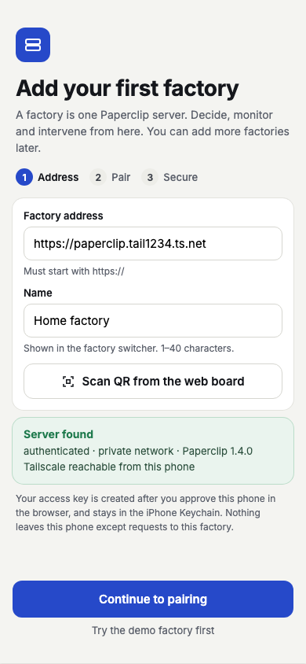

# Paperclip Agent Factory Mobile

Native iPhone and Android apps for deciding, monitoring and intervening in one or more [Paperclip](https://docs.paperclip.ing) AI-agent instances from anywhere, through the Paperclip REST API. All non-UI code is one shared Kotlin Multiplatform core; the iPhone UI is SwiftUI and the Android UI will be Jetpack Compose.

**Status:** Phase 1a (shared contracts) is merged: the shared Kotlin core is complete for 15 screens and runs entirely on fakes (demo mode): domain, `operator fun invoke` use cases and policies, 16 state holders, a fake for each of the 23 ports, contract suites for the 21 that a real adapter could break, and the refresh policy. Phase 1b (branch `feat/phase-1b-adapters`, spec `specs/261102-phase-1b-adapters/`) adds the real adapters behind those ports: the Ktor HTTP client with error mapping and the eleven Paperclip gateways (health, auth and pairing, attention, decision, approval, budget, issue, interaction, agent, run, dashboard), proven against a stub server; the SQLDelight database with the SQL instance, settings and Inbox-cache adapters; the iOS Keychain secret store, LocalAuthentication biometrics, network monitor and system services (fail-closed secret store and biometrics for Android and the JVM); `PaperclipCore.createLiveGraph` (and the throwing `openLiveGraph`) that wires them into the same graph surface the demo graph has; and `contractTest`, which runs the production adapters against the pinned Paperclip server in Docker in CI (`contract.yml`; see [docs/technical-details.md](./docs/technical-details.md#the-live-contract-test-contracttest-ad-050-ad-051) for what it counts as verified). The apps do not use the live graph yet: the iPhone app has **one screen**, the first-run address check, and the Android app is not built. Architecture is enforced by Konsist rules (count in the technical details). Details: [docs/technical-details.md](./docs/technical-details.md), [specs/261102-phase-1b-adapters/status.md](./specs/261102-phase-1b-adapters/status.md) and [specs/archive/261101-phase-1a-shared-contracts/status.md](./specs/archive/261101-phase-1a-shared-contracts/status.md).

| | Built (iPhone, running) | Design mock (target) |
|---|---|---|
| First-run setup |  |  |

## Documents

| File | What it holds |
|---|---|
| [INTENT.md](./INTENT.md) | Why the product exists and how to make trade-offs |
| [PRD](./paperclip-agent-factory-mobile-PRD.md) | Requirements, screens, release plan |
| [AGENTS.md](./AGENTS.md) | How we build: toolchain, TDD, Clean Architecture, security rules |
| [docs/product-summary.md](./docs/product-summary.md) | What the app does, in plain words, and where it stands |
| [docs/product-details.md](./docs/product-details.md) | The 16 screens: state holder, behaviour by role, device authentication, offline; mocks versus built |
| [docs/technical-details.md](./docs/technical-details.md) | Modules, graph API, layering rules, mutation order, refresh policy, errors, tests and coverage, iOS interop, known limitations |
| [docs/architectural-decision-record.md](./docs/architectural-decision-record.md) | ADR-001 to ADR-037: why we chose what we chose |
| [user-docs/README.md](./user-docs/README.md) | Index of the guides below |
| [user-docs/getting-started.md](./user-docs/getting-started.md) | Prerequisites, build, gates, XCFramework, iOS tests, demo graph |
| [user-docs/configuration-reference.md](./user-docs/configuration-reference.md) | Every build and configuration knob and validation rule |
| [user-docs/usage-examples.md](./user-docs/usage-examples.md) | Verified Kotlin and Swift snippets |
| [user-docs/testing-guide.md](./user-docs/testing-guide.md) | TDD, fakes, contract suites, Konsist, Kover; adding a use case or a screen |
| [user-docs/first-factory.md](./user-docs/first-factory.md) | The address step, the only built screen |
| [specs/archive/261101-phase-1a-shared-contracts/](./specs/archive/261101-phase-1a-shared-contracts/status.md) | The Phase 1a specification, research, notes and status |
| [specs/261101-iphone-app/plan.md](./specs/261101-iphone-app/plan.md) | The iPhone implementation plan |

## Build and run (macOS)

Needs a current Xcode (developed with 27.2), JDK 21 (Gradle finds or downloads it; do not set `JAVA_HOME`), and `brew install swiftlint xcodegen`. Gradle needs the Android SDK: put its path in a git-ignored `local.properties` (`sdk.dir=/Users/you/Library/Android/sdk`). Run one Gradle build at a time. Step by step: [user-docs/getting-started.md](./user-docs/getting-started.md).

```bash
./gradlew spotlessApply              # fix formatting
./gradlew check lint                 # format, static analysis, architecture rules, tests (JVM, Android host, iOS simulator), coverage
./scripts/build-kit.sh               # builds PaperclipKit.xcframework into iosApp/Frameworks (keeps the old one if the build fails)
./scripts/ios-test.sh                # generates the Xcode project, runs the iOS unit and UI tests
open iosApp/iosApp.xcodeproj         # after ./scripts/ios-test.sh, run the "iosApp" scheme on a simulator
```

### Demo graph (the whole core on fakes, no server)

`PaperclipCore.createDemoGraph()` builds the graph on fakes seeded with the design mocks' data (Home factory, Acme Labs, PAP-1182, Engineer 1; ADR-026) and every screen's state holder can be driven from it: `graph.attention`, `graph.work`, `graph.agents`, `graph.runs`, `graph.factory`, `graph.createFactoriesStateHolder()` and the other setup holders, `graph.refresh` for the refresh policy and `graph.lifecycle.setForeground(Bool)` for background and foreground (one call: refresh policy and app lock). `PaperclipCore.createGraph(allowInsecureLocal)` is the same wiring on empty fakes (auto-approving biometrics, a clock that does not move; ADR-037); it is what the iPhone app calls until Phase 1b brings real adapters. Kotlin and Swift examples, all verified: [user-docs/usage-examples.md](./user-docs/usage-examples.md). The Swift tests that do this are `DemoGraphInteropTests.swift`.

### A Paperclip server for contract tests

```bash
./scripts/paperclip-test-server.sh up     # pinned Paperclip in Docker, authenticated mode, http://127.0.0.1:3199
./scripts/paperclip-test-server.sh down   # stop and delete its data
```

It uses host port 3199, so your own Paperclip on 3100 is untouched. The app refuses servers in `local_trusted` mode by design. `scripts/contract-smoke.sh` checks the pinned server's health and pairing shapes in CI; the Kotlin `contractTest` (the real adapters against the pinned container, run by `contract.yml`) is described in [docs/technical-details.md](./docs/technical-details.md#the-live-contract-test-contracttest-ad-050-ad-051): `PAPERCLIP_CONTRACT_I_KNOW_THIS_MUTATES=true PAPERCLIP_CONTRACT_BASE_URL=http://localhost:3199 ./gradlew :shared:infrastructure:api:contractTest` after `./scripts/paperclip-test-server.sh up` and `invite`.

## Contributing

Read [INTENT.md](./INTENT.md) and [AGENTS.md](./AGENTS.md) first. Work is test-first (red, green, refactor), one logical change per pull request, Conventional Commits, and the docs change in the same pull request as the behaviour. A change to `shared/` and the UI that consumes it are separate pull requests, shared first.
