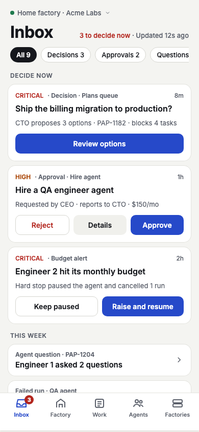
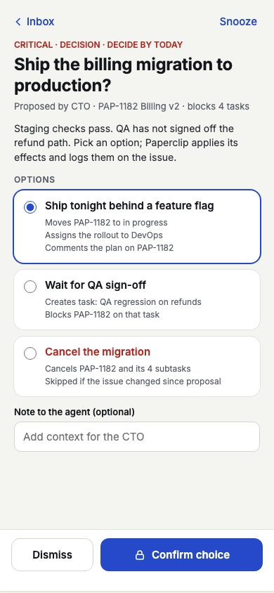
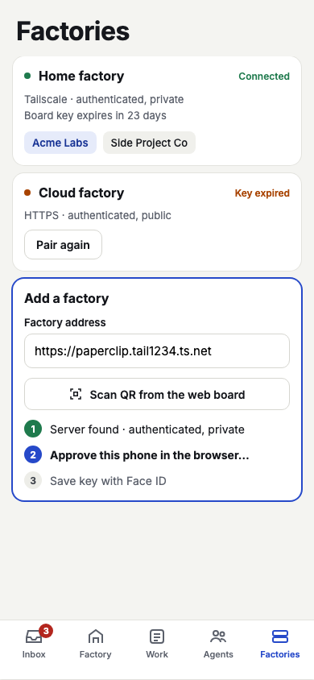
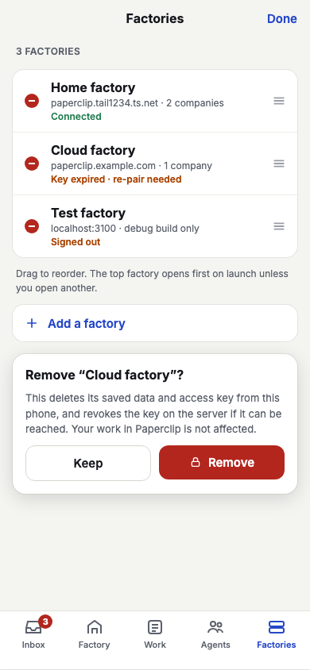
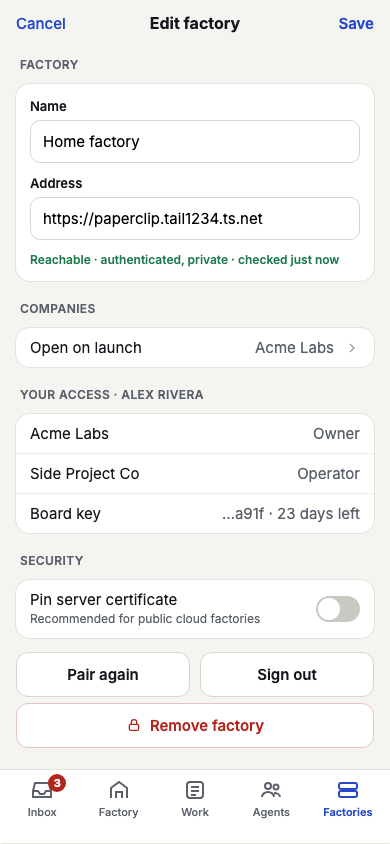
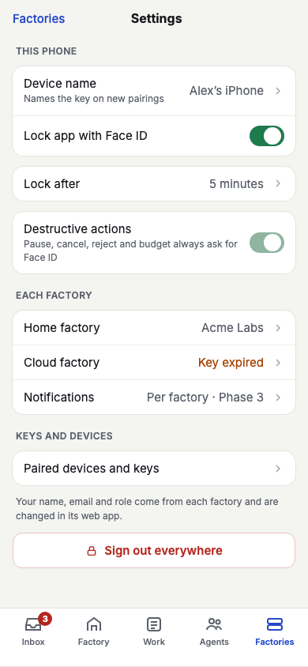

# Product details

Screens and behaviour. Requirements are numbered in the [PRD](../paperclip-agent-factory-mobile-PRD.md). The numbered screen inventory is the PRD's; the order below follows it.

**What exists today.** All 15 Phase 1a screens have a tested state holder in the shared Kotlin core, so the behaviour below is built and verified by tests on the demo data. Only one screen has a UI: the first step of First-run setup on iPhone. Every other screen has no SwiftUI or Compose view yet (Phase 2). Screen 14 (Notification settings) belongs to Phase 3 and has no state holder.

**About the images.** The images in `docs/images/design-*.png` are **design mocks** rendered from [Paperclip-Remote-mobile-UI-design.html](../Paperclip-Remote-mobile-UI-design.html); they show demo data and are a target, not the product. `docs/images/ios-first-run.png` is the only **built** screenshot (the running iPhone app). Mocks exist for seven screens; the other screens have none. Real screenshots replace mocks as the screens are built.

## Roles, device authentication, offline: rules that apply everywhere

| Rule | Behaviour |
|---|---|
| Roles | Per company: Owner, Operator, Viewer, mapped fail-closed from the server's membership role (ADR-011). A Viewer sees everything and can change nothing. Owner and Operator differ only on raising a budget and setting an agent's monthly budget, both Owner only. Local actions (add, edit, remove, sign out a factory, settings) are open to every role. |
| Device authentication | Face ID, fingerprint or device PIN, asked inside the use case before the server call, for: reject an approval, pause an agent, cancel a run, a destructive decision option, raise and resume a budget, remove a factory. Cannot be turned off. For a decision the app first reads the decision again, so what it asks about is the server's current copy. If it is cancelled, fails, is locked out or is unavailable, nothing is sent. |
| Mutations | Sent once, never retried. A second tap while an action runs is ignored. After a timeout or a conflict the screen reads the item again and shows what really happened; when the app cannot tell (run now, comments) it says the outcome is unknown and reloads, never "done" or "skipped". A "no permission" answer makes the screen read your role again and show only what that role may do. |
| Offline | A screen keeps what it last showed with its "Updated" time and every action is disabled with a reason (`ActionsDisabledReason.Offline`). Nothing refreshes in the background or offline. The Inbox shows its cached first page, or an explanation when there is no cache. |
| Text | State holders emit keys (enums), not sentences; the UI owns wording and localisation. |
| Refresh | 15 s while visible, 5 s for a live run, none when the item is final (see [technical-details.md](./technical-details.md#refresh-policy)). |

## Built UI

### Screen 15: First-run setup, step 1 (address check)

State holder `FirstRunStateHolder`. FR-003 and FR-009. The address of the Paperclip server is checked as you type, by the shared core:

- it must start with `https://`; `http://` is accepted only for `localhost` and `10.0.2.2` in debug builds;
- scheme and host are lower-cased and a trailing `/` is removed; a path prefix such as `/paperclip` and an explicit port are kept;
- user names and passwords, query strings and fragments are refused, with a message saying what to remove;
- a path with spaces, control characters, `..`, empty parts (`//`) or a broken `%` escape, and a host with an empty part, a trailing dot, non-ASCII letters (use the punycode form) or a malformed IP address are refused too.

"Continue to pairing" is enabled for a valid address and does nothing yet. The rest of the flow (name, server check, pairing, company, app lock) is in the state holder and tested, with no view.

| Built (iPhone, running) | Design mock (target) |
|---|---|
|  |  |

### Screens 10 and 4: Work list and Issue (iPhone, milestone 2i-5)

Built on `WorkListStateHolder` and `IssueStateHolder`; everything below runs on the demo graph.

- **Work tab.** Search box (sent when you press Search; clearing it shows the filter again), five saved-filter chips, the issue count with its "Updated" time, and one card per issue: number, title, status and priority pills, assignee. "New issue" (Operator and Owner) asks for a title and a priority and opens the new issue. More rows load when you reach the end of the list. Offline: the saved rows stay, with a banner.
- **Issue screen.** Header as in the mock (number and project, title, status, priority, assignee), the parent and what blocks it as links, subtasks, then Thread, Plan, Runs and Files. Thread lists comments and the agent's request cards in time order. A question card shows its questions and options and sends the answers once all required ones are filled in; the shared card says what is missing. The bar at the bottom changes the status (clock button), takes a comment, and offers "Reopen with this comment" or "Interrupt the running agent" only when the issue allows it. The assignee pill opens a menu of people to assign. Runs open the Run viewer. Files are listed (name, type, size) and open in the web app.
- **No Face ID.** None of these actions is on the destructive list; the prompt count stays unchanged and a failed action is never retried.
- No design mock exists for the Work list; it is designed from the state and the tokens of the other tabs.

## State holders only (no UI yet)

Each screen below is a `StateFlow<State>` plus `onIntent(Intent)` in `shared/presentation`, reached through `PaperclipGraph`. "Mock" means a design image exists; the rest have no image.

### Setup and settings

| # | Screen | State holder | What it shows and lets you do | Auth, roles, offline |
|---|---|---|---|---|
| 15 | First-run setup | `FirstRunStateHolder` | Steps Address, Pair, Secure, Done. Address check; server check (`GET /api/health`) that refuses `local_trusted`, unknown modes, a server awaiting bootstrap, and one that is not ready; name; pairing by approving in the browser, or a pasted board key; default company; app lock; an option to run on the demo data. | Roles do not apply (local). Pairing cancel or expiry leaves nothing stored. |
| 8 | Factories | `FactoriesStateHolder` | Your factories in order with status (signed in, signed out, needs re-pairing), key expiry (valid, expiring soon, expired, none), reachable companies with your role; select a factory and company. | `isOffline`, `canRefresh`. No device authentication. |
| 16 | Manage factories | `ManageFactoriesStateHolder` | Reorder; remove a factory after a confirmation that lists what goes (configuration, cached data, stored key, server key). | Remove needs device authentication. |
| 9 | Add / edit factory | `EditInstanceStateHolder` | Name, address, server check, default company, your roles, certificate pins (SHA-256 SPKI, base64), re-pair, sign out, remove. Changing the address drops the stored key and leaves the factory signed out (ADR-012). | Remove needs device authentication; sign out always deletes local secrets and reports whether the server revoke was confirmed. |
| 13 | Settings and profile | `SettingsStateHolder` | Device name (1 to 60 characters), app lock on or off, idle period (immediately, 1, 5, 15, 30 minutes or 1 hour), the factories with status, the signed-in person, paired devices and board keys with revoke, sign out of one factory or everywhere. "Destructive actions always ask" is always on. | Revoke and sign out need no authentication. Revoking a key is refused ("this phone does not know which key is its own") when the factory has no stored key id. |
| - | App shell | `AppStateHolder` | Lock state (locked on a cold launch when app lock is on; relocks after the idle period), whether to show setup or the tabs, the selected factory and company. | Unlock asks the device owner. |

### Decide and intervene

| # | Screen | State holder | What it shows and lets you do | Auth, roles, offline |
|---|---|---|---|---|
| 1 | Inbox | `InboxStateHolder` | Cards grouped Decide now, This week, Whenever; filter chips by source kind with server counts; "<n> new or due today" badge (the server's `deskBadgeCount`); "Updated" time; load more. Inline Approve and Reject on resolvable approvals, Keep paused and Raise and resume on hard-stop budget alerts; Snooze (an hour, tonight 20:00, tomorrow 08:00, next Monday 08:00 in the phone's time zone), Dismiss and set decide-by, with a five-second undo. | Reject asks for a note and device authentication. Viewers and offline: actions disabled with a reason. Cached first page shown first. |
| 2 | Decision detail | `DecisionStateHolder` | Title, body, agent, decide-by, expiry, each option with the effects it will run (comment, create or update issue, assign, cancel issue tree, resolve blocker), required inputs, then the result of each effect (executed, skipped, failed). Snooze in the top bar only when opened from an Inbox card. A decision decided, expired or cancelled elsewhere shows its final state and no options. | Destructive options, and any that cancel an issue tree, need device authentication. A viewer cannot decide. Offline: disabled. |
| 3 | Approval detail | `ApprovalStateHolder` | Payload per approval type, linked issues, comments. Approve (from pending or revision requested), Reject (note required), Request revision (pending only, note required), Comment. | Reject needs device authentication. Viewer: read only. |
| 12 | Budget incident sheet | `BudgetIncidentStateHolder` | The incident with observed spend and limit; Keep paused, or Raise and resume with an amount that must exceed the observed spend. Shows `KeptPaused`, `Raised` or `NoLongerActive`; it cannot tell resolved from dismissed (ADR-029). | Keep paused: Operator and Owner. Raise: Owner only and needs device authentication. |
| 4 | Issue detail | `IssueStateHolder` | Header (status, priority, assignee, project, parent, subtasks); tabs Thread, Plan (read only), Runs, Files; comment (optionally reopen or interrupt); change status or assignee; add subtask; interaction forms (suggested tasks, questions, confirmation, checkbox confirmation, per-item verdicts). Forms say what is missing before sending; a card for someone else, already resolved or of an unknown kind is read only. | Viewer cannot comment or respond. No device authentication. |
| 7 | Run viewer | `RunViewerStateHolder` | Run events and a log tail that follows the end until you scroll up (`UserScrolled`), then `JumpToLatest`. | Cancel run: confirm, then device authentication; Operator and Owner. A run that finished shows its final state. |

### Know

| # | Screen | State holder | What it shows and lets you do | Auth, roles, offline |
|---|---|---|---|---|
| 5 | Factory home | `FactoryHomeStateHolder` | Tiles for agents, tasks, month spend against budget, pending approvals and budget incidents; runs in progress; rolling spend for 5 hours, 24 hours and 7 days. | Read only. Keeps last data offline. |
| 6 | Agents | `AgentsStateHolder` | Needs attention (error, budget-paused, waiting for approval), Running, Paused, Idle. Pause, Resume, Run now. | Pause: confirm, then device authentication. Resume is not offered for a budget pause. Run now needs no prompt. Operator and Owner. |
| 11 | Agent detail | `AgentDetailStateHolder` | Role, reports to, current issue (from its live run), recent runs, month spend against budget. Pause, Resume, Run now, set monthly budget. | Same as Agents; the budget is Owner only, no authentication. |
| 10 | Work list | `WorkListStateHolder` | Saved filters All open, Blocked, Critical and high, In review, Assigned to me; search by identifier in any spelling (`PAP-1182`, `pap1182`); paged. Create an issue. | Operator and Owner create; Viewer cannot. "Critical and high" is filtered on the phone. |

### Not started

| # | Screen | Note |
|---|---|---|
| 14 | Notification settings | Phase 3 (FR-083, FR-086). No state holder. Content-free notifications by default. |

## Design mocks

Mocks of seven screens from the design file. These are **targets**, not built UI.

| Screen | Mock |
|---|---|
| Inbox (screen 1, FR-030 to FR-035) |  |
| Decision (screen 2, FR-040 to FR-044) |  |
| Factories (screen 8, FR-001 to FR-008) |  |
| Manage factories (screen 16, FR-006) |  |
| Edit factory (screen 9, FR-001, FR-016, FR-017) |  |
| Settings and profile (screen 13, FR-014, FR-017) |  |
| First-run setup (screen 15, FR-003, FR-009) | see the table above |

The mocks show a few things the core does not model, so the demo data omits them: an agent's next heartbeat, the "Tailscale" network label, the default company name per factory in Settings, a company count in Manage factories, and the key tail in Edit factory. The mock lists the Inbox approval second in "Decide now"; the core sorts a group by severity (FR-030), so the critical budget stop comes second.
