# Product details

Screens and behaviour. Requirements are numbered in the [PRD](../paperclip-agent-factory-mobile-PRD.md). The numbered screen inventory is the PRD's; the order below follows it.

**What exists today.** The shared Kotlin core has a tested state holder for every screen. The iPhone app (Phase 2i) and the Android app (Phase 2a, Jetpack Compose) both draw screens 1 to 13, 15 and 16 on the real Phase 1b adapters, and on the demo graph (`-demo` on iPhone, the `demo` Intent extra on Android, both in Debug builds only). Screen 14 (Notification settings) belongs to Phase 3.

**About the images.** Screenshots in `docs/images/` without a prefix are real captures of the running iPhone app in **demo mode**; `android-*.png` are the Roborazzi baselines of the Android app, drawn from the demo graph (fake data only; the pairing screen is never captured). The `design-*.png` files are the original mocks, kept for comparison.

## Roles, device authentication, offline: rules that apply everywhere

| Rule | Behaviour |
|---|---|
| Roles | Per company: Owner, Operator, Viewer, mapped fail-closed from the server's membership role (ADR-011). A Viewer sees everything and can change nothing. Owner and Operator differ only on raising a budget and setting an agent's monthly budget, both Owner only. Local actions (add, edit, remove, sign out a factory, settings) are open to every role. |
| Device authentication | Face ID, fingerprint or device PIN, asked inside the use case before the server call, for: reject an approval, pause an agent, cancel a run, a destructive decision option, raise and resume a budget, set an agent's monthly budget above its current amount or to zero (a decrease asks nothing; DEC-1, confirmed by the owner 2026-11-05, ADR-141), remove a factory. Cannot be turned off. For a decision the app first reads the decision again, so what it asks about is the server's current copy. If it is cancelled, fails, is locked out or is unavailable, nothing is sent. |
| Mutations | Sent once, never retried. A second tap while an action runs is ignored. After a timeout or a conflict the screen reads the item again and shows what really happened; when the app cannot tell (run now, comments) it says the outcome is unknown and reloads, never "done" or "skipped". A "no permission" answer makes the screen read your role again and show only what that role may do. |
| Offline | A screen keeps what it last showed with its "Updated" time and every action is disabled with a reason (`ActionsDisabledReason.Offline`). Nothing refreshes in the background or offline. The Inbox shows its cached first page, or an explanation when there is no cache.  On Android the phone counts as online whenever its default network declares internet access, validated or not (DEC-2, confirmed by the owner 2026-11-05, ADR-142). |
| Text | State holders emit keys (enums), not sentences; the UI owns wording and localisation. |
| Refresh | 15 s while visible, 5 s for a live run, none when the item is final (see [technical-details.md](./technical-details.md#refresh-policy)). |

## Built UI (iPhone, demo mode)

| Screen | Image |
|---|---|
| First run, address step (15) | 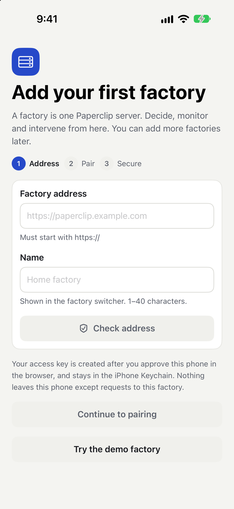 |
| Inbox (1) | 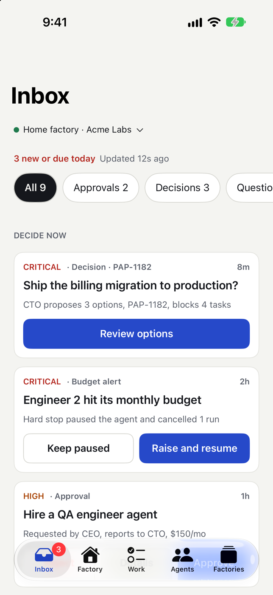 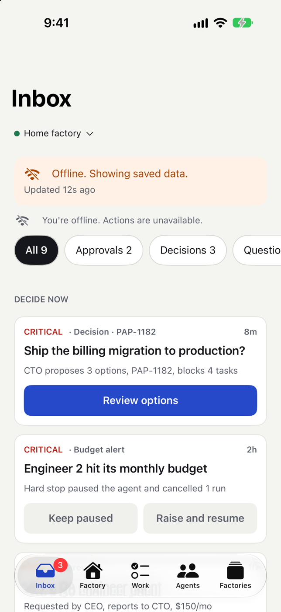 |
| Decision (2) | 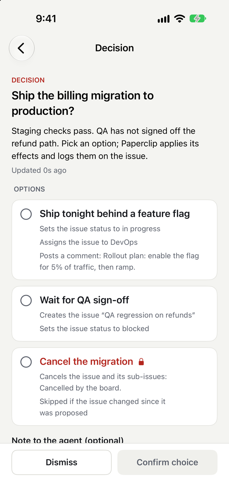 |
| Approval (3) | 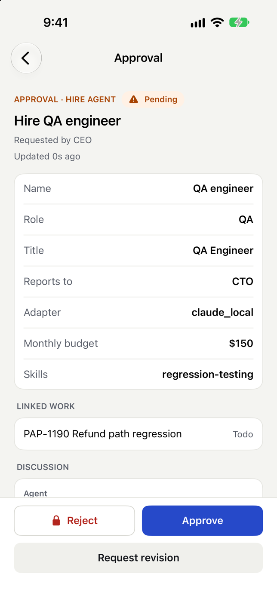 |
| Budget incident (12) | 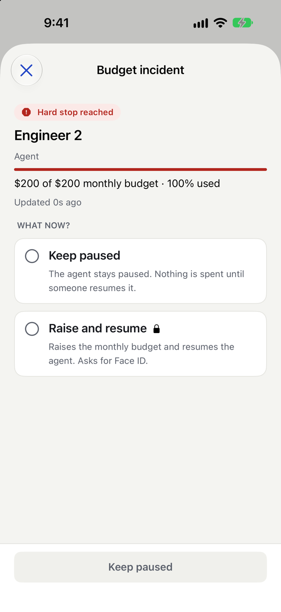 |
| Factory home (5) | 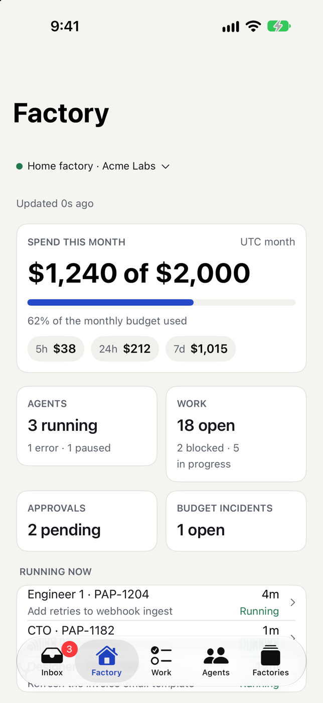 |
| Agents (6) and Agent detail (11) | 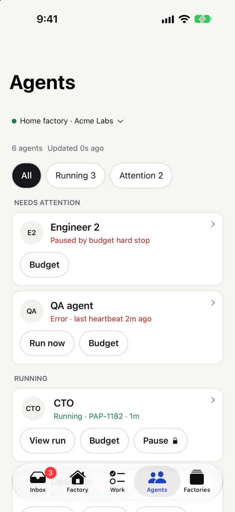 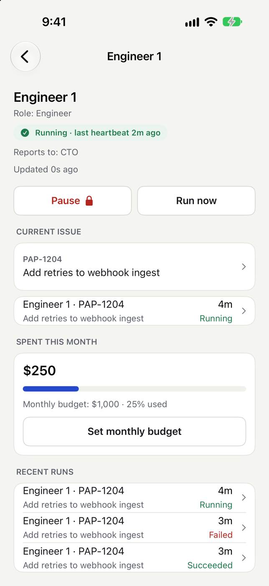 |
| Run viewer (7) | 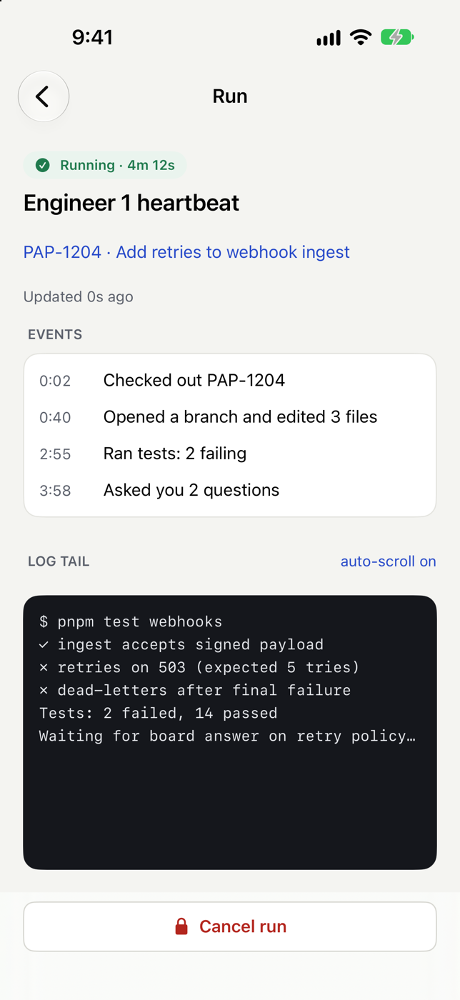 |
| Work (10) and Issue (4) | 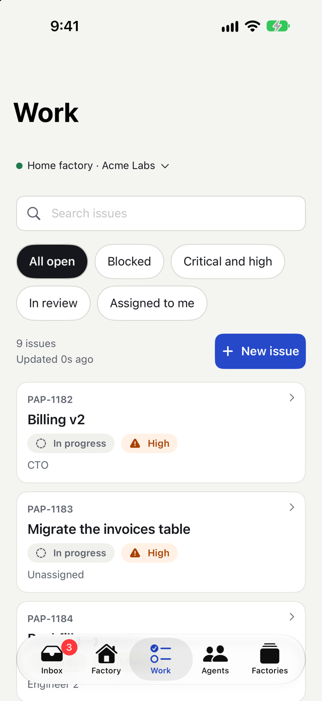 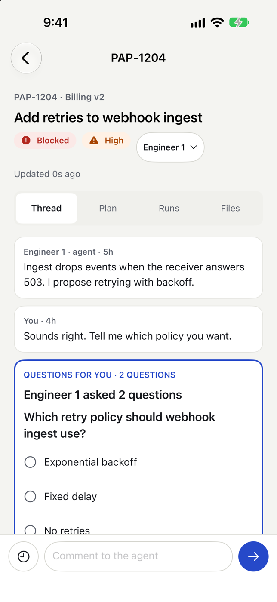 |
| Factories (8), Manage (16) | 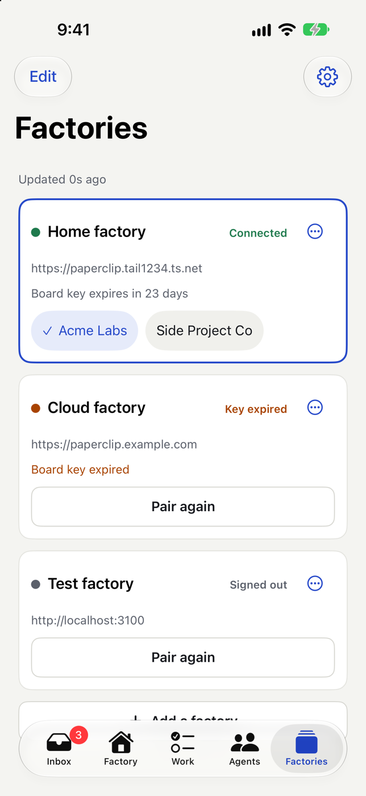 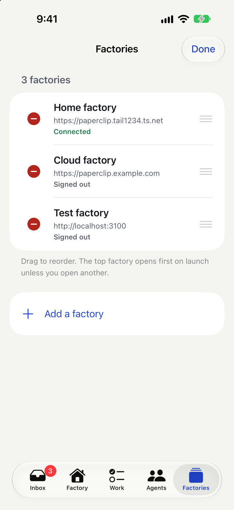 |
| Edit factory (9), Settings (13) | 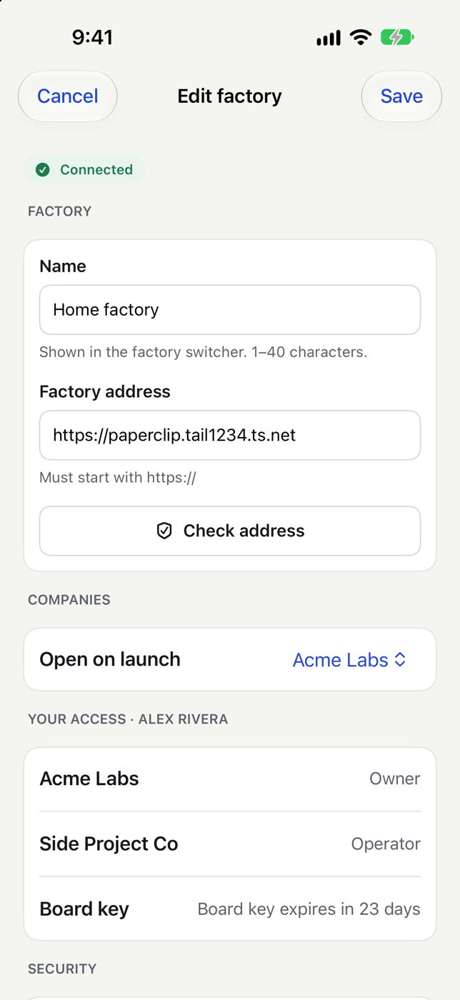 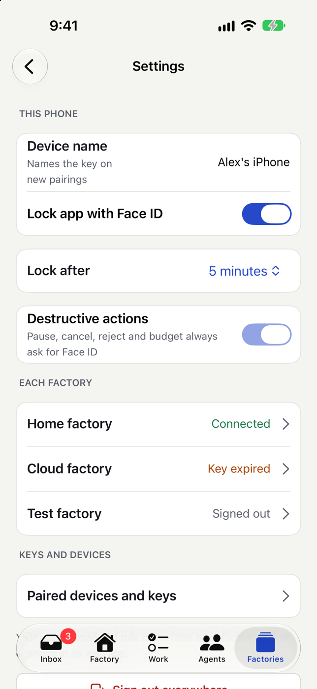 |
| Dark mode, large text | 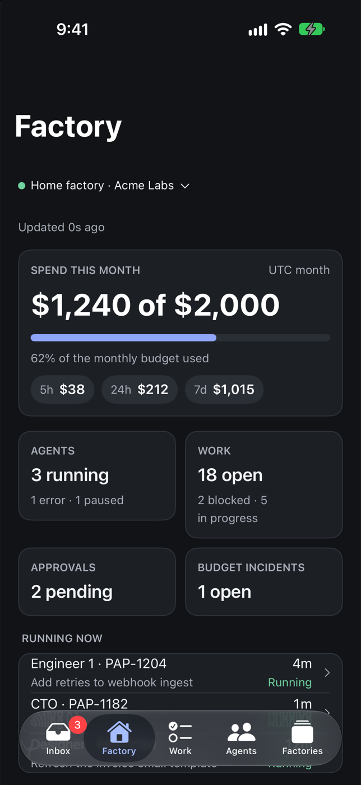 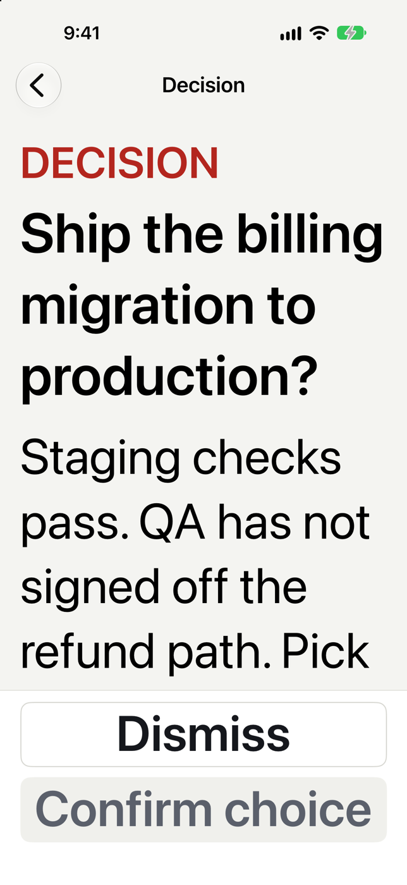 |

### Polish and accessibility (UI-060)

- **Text size.** Fonts scale with Dynamic Type; layouts switch to stacked arrangements at accessibility sizes; the app is exercised at the largest accessibility size in screenshots and audits.
- **Dark mode.** One palette with a tested dark variant.
- **VoiceOver.** Controls carry labels and hints, cards read as one element, the Inbox tab reads "N waiting" as its value.
- **Targets.** Every control that is on screen between the navigation bar and the tab bar is at least 44 x 44 pt (`HitTargetUITests`, which fails when it measures too few controls and prints how many it could not see: below the fold or under the bars).
- **Motion and haptics.** The two explicit animations are off when Reduce Motion is on; success and failure haptics follow each action's outcome.
- **States.** Every screen has loading, empty, error and offline states; offline keeps the last data with its time and disables actions with a reason.

### Review-fix round (iPhone)

What changed for the person using the app after the three reviews of the iPhone UI (see implementation-notes.md, "Review-fix round"):

- **Live graph.** A launch without `-demo` (and every Release build, where `-demo*` is ignored) opens the real graph behind the app lock. If the factory database or the Keychain cannot be opened, the app says "Paperclip cannot start yet" with Try again, changes nothing and never runs on fakes. When the phone cannot read a key (Face ID declined, locked), Sign out and Remove offer "here only" versions that say the key stays live on the server.
- **Money you type is read strictly.** The Budget incident and Agent detail amounts are read by shared code with the phone's decimal mark. "250,50" typed where the decimal mark is "." is refused with a message (never read as 25,050); zero, negative, too-precise and too-large amounts are refused. The raise button reads "Raise to $250 and resume", and "Choose an option" until you choose.
- **Times keep moving.** "Updated 12s ago", card ages and a running run's elapsed time keep counting while the screen is open, also offline. Ages are in your language; VoiceOver reads them as words ("8 minutes").
- **Decision.** Shows when it expires; the bar above Confirm names the chosen option; effect lines show free text (a title or a comment excerpt) exactly as written.
- **Approval.** Linked issues open the Issue screen. Your comment box clears only when your own comment is posted, never because someone else's arrived.
- **Issue.** The comment box keeps your text until the comment is sent; a failed or refused send loses nothing and a sent one is never put back. The create-issue and subtask sheets stay open with your text when the server refuses, and close when it worked.
- **Agent detail.** "Working" shows while Pause, Resume or Run now runs. The budget form closes only when the budget was saved.
- **Edit factory and Settings.** Cancel asks before throwing away typed changes. The device name is saved when you leave the field or the screen, not only on Done.
- **Leaving a screen mid-request.** Going back during a request or a Face ID prompt does not lose the outcome: the screen finishes first, then goes away.
- **Privacy.** The app-switcher shield is a window above everything, so open sheets and the in-app browser are covered too. A pairing that ends (cancelled, expired, failed) closes its approval page.
- **Switcher dot.** Green only for a working key on a connected phone; amber for an expired key, re-pairing or an offline phone; grey when signed out.
- **Web links.** Only https links are opened (plain http only for `localhost` and `10.0.2.2` in Debug builds). Counts read right in the singular ("1 key", "1 factory").

### Screens 10 and 4: Work list and Issue (iPhone, milestone 2i-5)

Built on `WorkListStateHolder` and `IssueStateHolder`; everything below runs on the demo graph.

- **Work tab.** Search box (sent when you press Search; clearing it shows the filter again), five saved-filter chips, the issue count with its "Updated" time, and one card per issue: number, title, status and priority pills, assignee. "New issue" (Operator and Owner) asks for a title and a priority and opens the new issue. More rows load when you reach the end of the list. Offline: the saved rows stay, with a banner.
- **Issue screen.** Header as in the mock (number and project, title, status, priority, assignee), the parent and what blocks it as links, subtasks, then Thread, Plan, Runs and Files. Thread lists comments and the agent's request cards in time order. A question card shows its questions and options and sends the answers once all required ones are filled in; the shared card says what is missing. The bar at the bottom changes the status (clock button), takes a comment, and offers "Reopen with this comment" or "Interrupt the running agent" only when the issue allows it. The assignee pill opens a menu of people to assign. Runs open the Run viewer. Files are listed (name, type, size) and cannot be opened in the app: a note says they open in the web app, and no link is offered (no shared port for the bytes, ADR-064).
- **No Face ID.** None of these actions is on the destructive list; the prompt count stays unchanged and a failed action is never retried.
- No design mock exists for the Work list; it is designed from the state and the tokens of the other tabs.

## Android app (Phase 2a, demo graph)

The Android UI is Jetpack Compose over the same state holders. Every screen is a thin function over a stateless `*Content(state, send, ...)` that tests and screenshots drive with any state. Behaviour, rules and wording keys are the shared core's, so the roles, device-owner prompts, offline rules and refresh intervals in the table at the top apply unchanged; only the device prompt differs (a system `BiometricPrompt` that accepts a fingerprint, face or the screen lock, instead of Face ID). The images are the Roborazzi baselines in `androidApp/src/test/screenshots`, copied here.

| Screen | Android | Proof (a class in `androidApp/src/test`, unless marked connected) |
|---|---|---|
| First run, address step (15) | 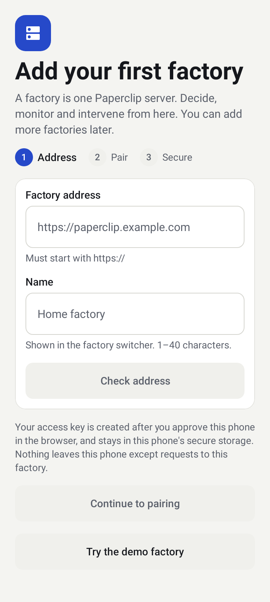 | `MainActivityTest` (the first-run flow walked to its end; a demo launch with no factory reaches first run, and Try the demo factory reaches the Inbox shell), `RootScreenTest.aGraphWithNoFactoryShowsFirstRun`, `RestorationTest`, `ShellLargeTextActionsTest`; connected: `ShellFlowsTest` |
| Inbox (1) | 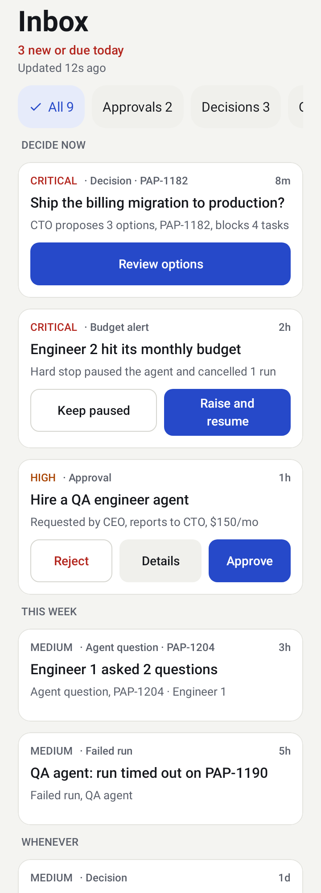 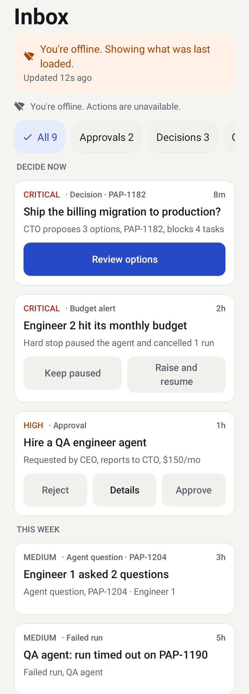 | `InboxScreenTest`, `InboxVariantsTest`, `InlineActionsBadgeTest`, `InboxFullyDrawnTest`, `LargeTextActionsTest`, `AttentionScreenshotTest`; connected: `AttentionFlowsTest` (snooze and dismiss with Undo) |
| Decision (2) | 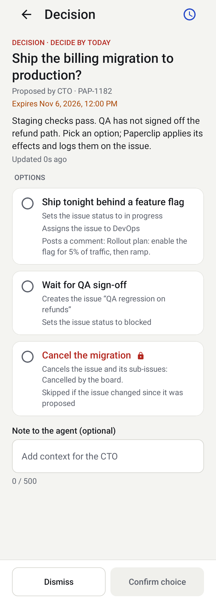 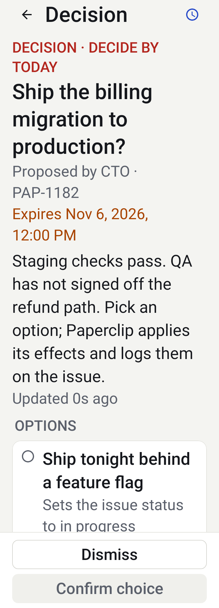 | `DecisionScreenTest`, `DecisionVariantsTest`, `DecisionPresentationTest`; connected: `AttentionFlowsTest` (non-destructive without a prompt; destructive cancelled, then approved) |
| Approval (3) | 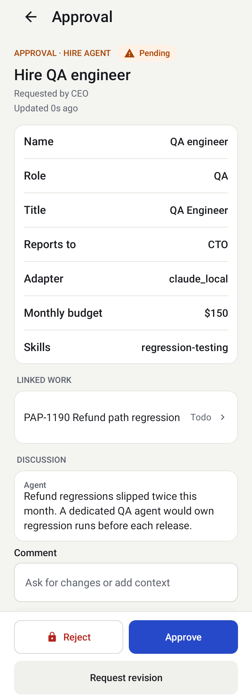 | `ApprovalScreenTest`, `ApprovalVariantsTest`, `ApprovalPresentationTest`; connected: `AttentionFlowsTest` (approve; reject with a note) |
| Issue (4) | 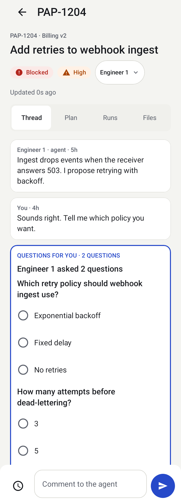 | `IssueScreenTest`, `IssueVariantsTest`, `InteractionCardTest`, `InteractionFlowTest` (main PRD criterion 7), `WebOpenerTest`, `WorkScreenshotTest` |
| Factory home (5) | 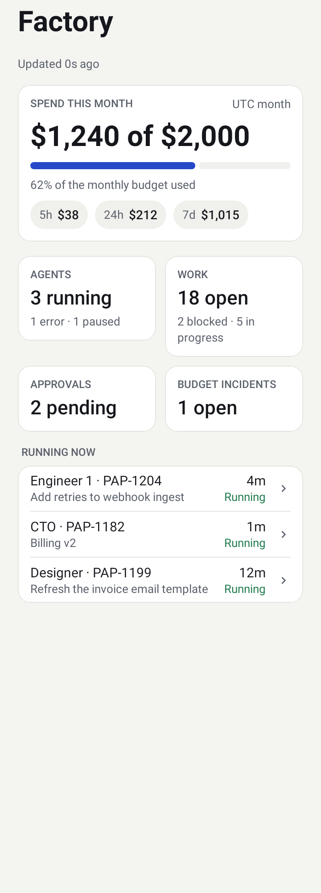 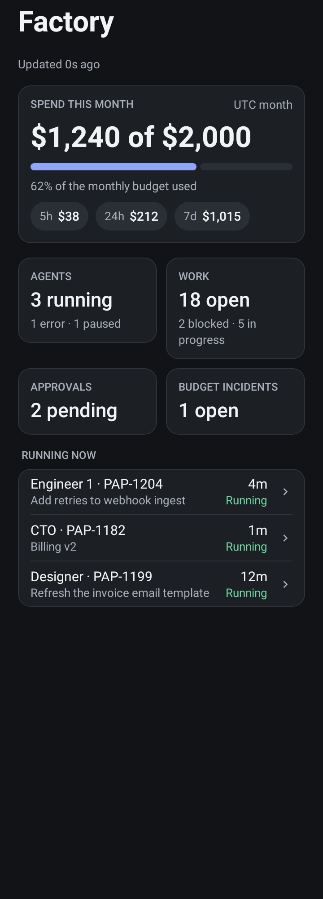 | `FactoryHomeScreenTest`, `OperationsScreenshotTest`, `OperationsLargeTextTest` |
| Agents (6) | 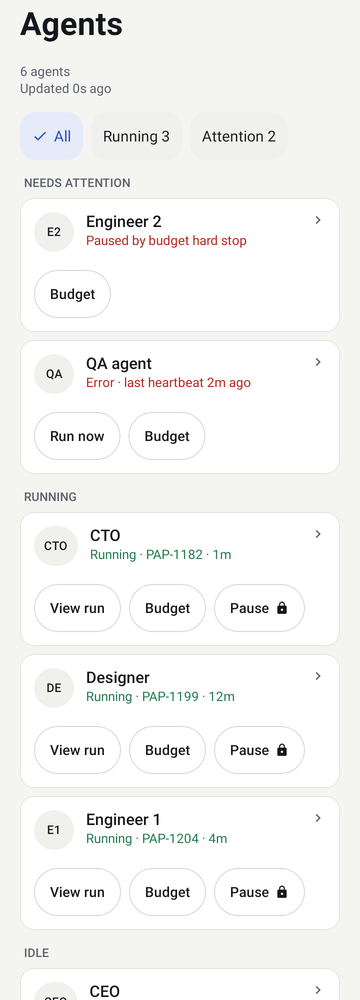 | `AgentsScreenTest`, `AgentVariantsTest`, `OperationsPresentationTest`; connected: `OperationsFlowsTest` (pause cancelled, then approved) |
| Run viewer (7) | 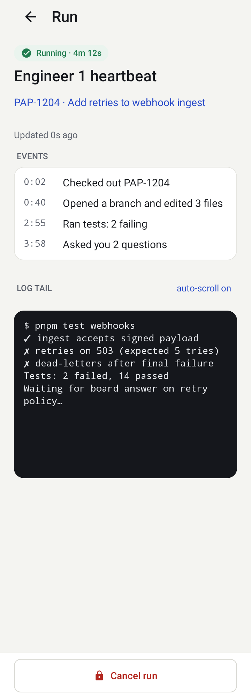 | `RunViewerScreenTest`, `RunViewerVariantsTest`, `RunRefreshTest` (5 s while live, none once final; a run cancelled on the server, not by the viewer, reads as cancelled after the next 5 s refresh, main PRD criterion 8; the timer runs in virtual time and the holder's own work in real time; a mutation that stops the timer fails it); connected: `OperationsFlowsTest` |
| Factories (8) | 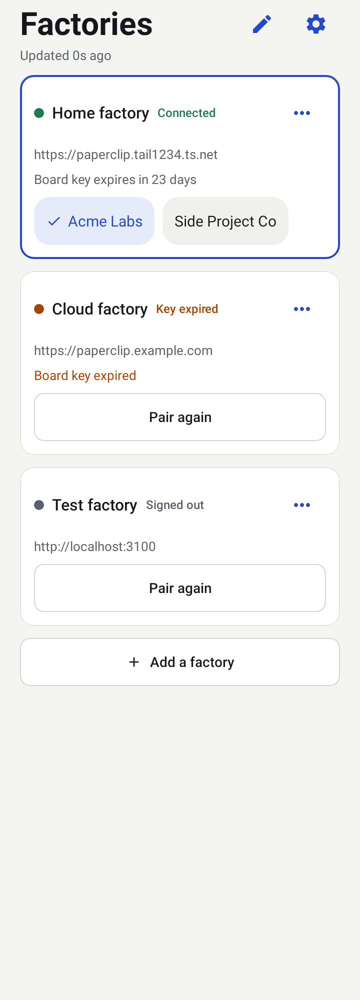 | `FactoriesScreenTest`, `FactoriesScreenshotTest`, `FactoryPresentationTest`; connected: `ShellFlowsTest` (switch factory and company) |
| Edit factory (9) and Add factory | 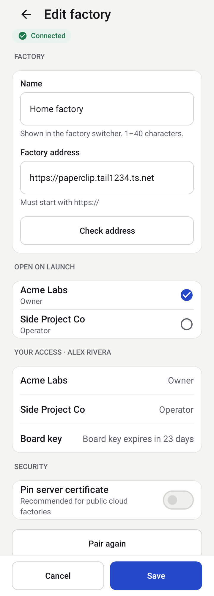 | `EditFactoryScreenTest`, `PairingRoutingTest`, `CustomTabsPairingBrowserTest` |
| Work list (10) | 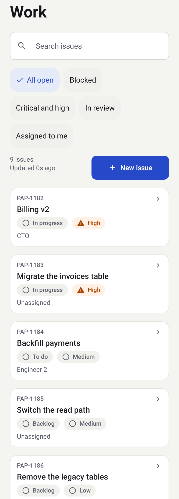 | `WorkListScreenTest`, `WorkListVariantsTest`, `WorkPresentationTest`, `WorkLargeTextTest`; connected: `OperationsFlowsTest` (create an issue) |
| Agent detail (11) | 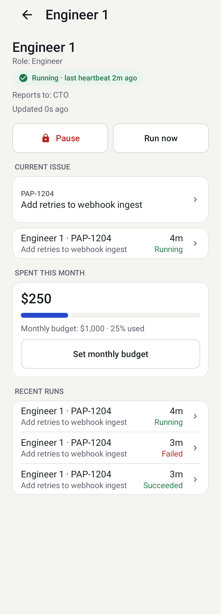 | `AgentDetailScreenTest`, `AgentVariantsTest` |
| Budget incident (12) | 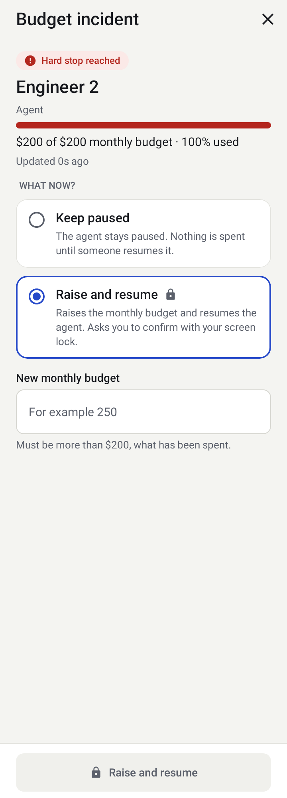 | `BudgetSheetTest`, `BudgetVariantsTest`; connected: `AttentionFlowsTest` (Keep paused) |
| Settings (13), Paired devices, Diagnostics | 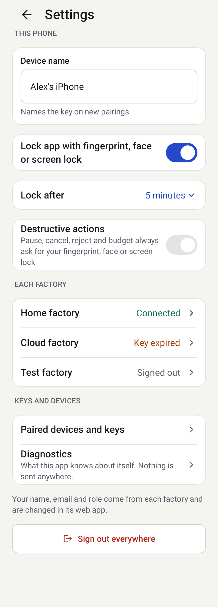 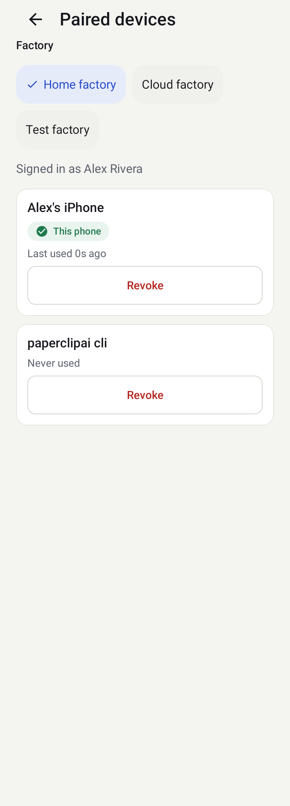 | `SettingsScreenTest`, `PairedDevicesScreenTest`, `DiagnosticsScreenTest`, `DiagnosticsReportTest`, `DiagnosticsRecorderTest`, `AppLogTest` |
| Manage factories (16) | 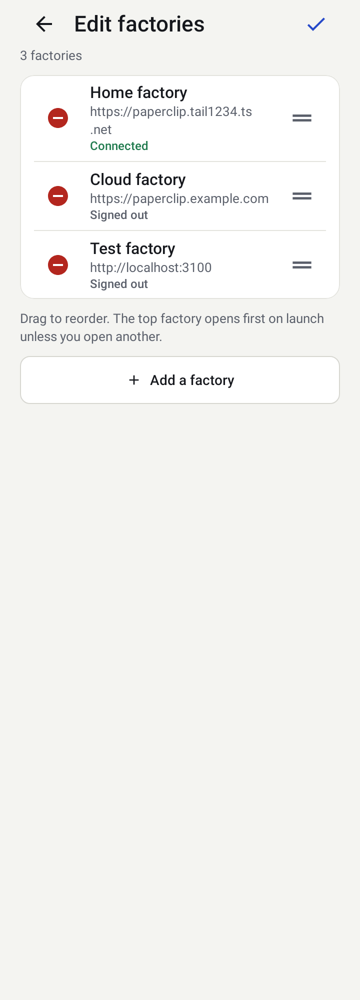 | `ManageFactoriesScreenTest`, `ReorderControllerTest` |
| App lock | 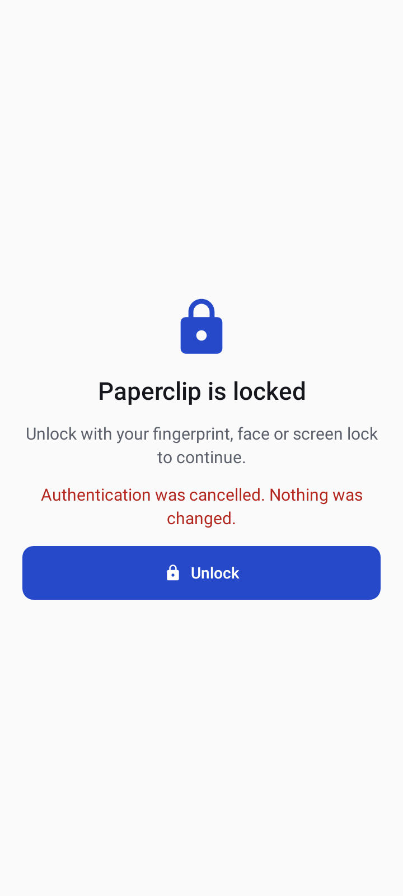 | `LockScreenTest`, `RootScreenTest`, `WindowPrivacyTest`, `RecentsPrivacyTest` (API 28, 33 and 36 under Robolectric) |

Two things are checked across every screen: `AccessibilityTest` (name, role, 48 dp target, reading order, status never by colour alone; ADR-134) and the font scale 2.0 guards (`LargeTextActionsTest`, `OperationsLargeTextTest`, `WorkLargeTextTest`, `ShellLargeTextActionsTest`). The device name in the Settings and Paired devices images ("Alex's iPhone") is the shared demo data set's value; the Android app does not read it from the phone.

### Behaviour that is Android's own

- **Device prompt.** A destructive action shows the app's confirmation sheet (lock glyph), then the shared use case asks `BiometricPromptBiometrics`: strong biometrics or the screen lock on API 30 and later, weak biometrics or the screen lock on API 28 and 29. No screen lock means the action is refused, never allowed.
- **Pairing** opens the approval page in a Custom Tab and finishes with the shared pairing flow ([pairing guide](../user-docs/pairing.md)). The window is `FLAG_SECURE` while the app is locked and while pairing, so Recents shows a blank thumbnail.
- **Navigation.** Five tabs with a back stack each, system and predictive back (the manifest sets `android:enableOnBackInvokedCallback`, checked by `AndroidManifestRulesTest` for every build type; the animation itself is for the API 33 and 34 run, [checklist](./android-verification-checklist.md) item 7), state restored after rotation and process death. Switching factory or company returns every tab to its root, so a detail screen of the old factory never stays on the stack (`TabShellTest`); locking the app closes every screen's holder and unlock lands on the tab root. System Back on the first-run Pair step cancels the pairing; on the Secure step it does nothing (the shared holder ignores it). A screen's holder is closed when its entry is cleared and kept across rotation (`HolderViewModelTest`, `HolderViewModelRotationTest`).
- **Theme.** Material 3 from the design tokens; dynamic colour reaches the neutral roles only (ADR-133); dark theme, 360 x 640 dp up to large phones; reduced motion follows the system animation setting; two haptic feelings.

### Parity ledger (final state of Phase 2a)

| Item | iPhone | Android | Where it is tracked |
|---|---|---|---|
| Screens 1 to 13, 15, 16 | Built | Built | the table above |
| Screen 14, Notification settings | Phase 3 | Phase 3 | no state holder yet |
| QR scan, `paperclipmobile://add` deep link (FR-004), export as QR (FR-008) | Not built | Not built | one follow-up for both platforms (Android PRD, parity ledger) |
| Live WebSocket events | None (board keys refused); polling | None; polling | [known limitations](./technical-details.md#known-limitations-and-gaps) |
| Demo mode | `-demo` argument, Debug only | `demo` Intent extra, Debug and `releaseDemo` builds | [configuration reference](../user-docs/configuration-reference.md) |
| Opening an issue's attachments | Listed, cannot be opened (a note points to the web app) | Listed, cannot be opened (the tab says so) | shared gap: no port for the bytes (ADR-064, ADR-131); the design for opening them is ADR-143, not built |
| Markdown in comments and plans | Rendered inline | Not rendered: plain text | no inline markdown on Android yet (2a-7 notes) |
| Factory switcher line on screen headers | Present | Not ported: the Factories tab switches | 2a-5 notes |
| Pull-to-refresh spinner on Agents, Run viewer, Issue, Work | not compared | None: those states have no `isRefreshing` | shared gap (2a-6 and 2a-7 notes) |
| Unsupported interaction kinds | Open in the web app | Open in the web app, https only | `WebOpenerTest` |
| Android only | n/a | Predictive back, dynamic colour for neutrals, Custom Tabs, screen-lock fallback in the prompt, Keystore keys with StrongBox where present | ADR-123, ADR-125, ADR-133 |
| Not proven on a device | | Real-phone check that a new fingerprint leaves the Android key valid (ADR-149), the system prompt on a destructive action with enrolled credentials, the number of prompts per refresh with app lock on (a device measurement; the design is decided, ADR-145), StrongBox hardware, a pairing against the pinned server, TalkBack, API 28 and 33, Pixel 6 and Samsung, the first hosted CI run; steps and a result line for each: [android-verification-checklist.md](./android-verification-checklist.md) | [known limitations](./technical-details.md#known-limitations-and-gaps), ADR-137 |

## Screen reference: state holders

Each screen below is a `StateFlow<State>` plus `onIntent(Intent)` in `shared/presentation`, reached through `PaperclipGraph`. "Mock" means a design image exists; the rest have no image.

### Setup and settings

| # | Screen | State holder | What it shows and lets you do | Auth, roles, offline |
|---|---|---|---|---|
| 15 | First-run setup | `FirstRunStateHolder` | Steps Address, Pair, Secure, Done. Address check; server check (`GET /api/health`) that refuses `local_trusted`, unknown modes, a server awaiting bootstrap, and one that is not ready; name; pairing by approving in the browser, or a pasted board key; default company; app lock; an option to run on the demo data. | Roles do not apply (local). Pairing cancel or expiry leaves nothing stored. |
| 8 | Factories | `FactoriesStateHolder` | Your factories in order with status (signed in, signed out, needs re-pairing), key expiry (valid, expiring soon, expired, none), reachable companies with your role; select a factory and company. | `isOffline`, `canRefresh`. No device authentication. |
| 16 | Manage factories | `ManageFactoriesStateHolder` | Reorder; remove a factory after a confirmation that lists what goes (configuration, cached data, stored key, server key). | Remove needs device authentication. |
| 9 | Add / edit factory | `EditInstanceStateHolder` | Name, address, server check, default company, your roles, certificate pins (SHA-256 SPKI, base64), re-pair, sign out, remove. Changing the address drops the stored key and leaves the factory signed out (ADR-012). | Remove needs device authentication; sign out always deletes local secrets and reports whether the server revoke was confirmed. |
| 13 | Settings and profile | `SettingsStateHolder` | Device name (1 to 60 characters), app lock on or off, idle period (immediately, 1, 5, 15, 30 minutes or 1 hour), the factories with status, the signed-in person, paired devices and board keys with revoke, sign out of one factory or everywhere. "Destructive actions always ask" is always on. | Revoke and sign out need no authentication. Revoking a key is refused ("this phone does not know which key is its own") when the factory has no stored key id. |
| - | App shell | `AppStateHolder` | Lock state (locked on a cold launch when app lock is on; relocks after the idle period), whether to show setup or the tabs, the selected factory and company. | Unlock asks the device owner. |

### Decide and intervene

| # | Screen | State holder | What it shows and lets you do | Auth, roles, offline |
|---|---|---|---|---|
| 1 | Inbox | `InboxStateHolder` | Cards grouped Decide now, This week, Whenever; filter chips by source kind with server counts; "<n> new or due today" badge (the server's `deskBadgeCount`); "Updated" time; load more. Inline Approve and Reject on resolvable approvals, Keep paused and Raise and resume on hard-stop budget alerts; Snooze (an hour, tonight 20:00, tomorrow 08:00, next Monday 08:00 in the phone's time zone), Dismiss and set decide-by, with a five-second undo. | Reject asks for a note and device authentication. Viewers and offline: actions disabled with a reason. Cached first page shown first. |
| 2 | Decision detail | `DecisionStateHolder` | Title, body, agent, decide-by, expiry, each option with the effects it will run (comment, create or update issue, assign, cancel issue tree, resolve blocker), required inputs, then the result of each effect (executed, skipped, failed). Snooze in the top bar only when opened from an Inbox card. A decision decided, expired or cancelled elsewhere shows its final state and no options. | Destructive options, and any that cancel an issue tree, need device authentication. A viewer cannot decide. Offline: disabled. |
| 3 | Approval detail | `ApprovalStateHolder` | Payload per approval type, linked issues, comments. Approve (from pending or revision requested), Reject (note required), Request revision (pending only, note required), Comment. | Reject needs device authentication. Viewer: read only. |
| 12 | Budget incident sheet | `BudgetIncidentStateHolder` | The incident with observed spend and limit; Keep paused, or Raise and resume with an amount that must exceed the observed spend. Shows `KeptPaused`, `Raised` or `NoLongerActive`; it cannot tell resolved from dismissed (ADR-029). | Keep paused: Operator and Owner. Raise: Owner only and needs device authentication. |
| 4 | Issue detail | `IssueStateHolder` | Header (status, priority, assignee, project, parent, subtasks); tabs Thread, Plan (read only), Runs, Files; comment (optionally reopen or interrupt); change status or assignee; add subtask; interaction forms (suggested tasks, questions, confirmation, checkbox confirmation, per-item verdicts). Forms say what is missing before sending; a card for someone else, already resolved or of an unknown kind is read only. | Viewer cannot comment or respond. No device authentication. |
| 7 | Run viewer | `RunViewerStateHolder` | Run events and a log tail that follows the end until you scroll up (`UserScrolled`), then `JumpToLatest`. | Cancel run: confirm, then device authentication; Operator and Owner. A run that finished shows its final state. |

### Know

| # | Screen | State holder | What it shows and lets you do | Auth, roles, offline |
|---|---|---|---|---|
| 5 | Factory home | `FactoryHomeStateHolder` | Tiles for agents, tasks, month spend against budget, pending approvals and budget incidents; runs in progress; rolling spend for 5 hours, 24 hours and 7 days. | Read only. Keeps last data offline. |
| 6 | Agents | `AgentsStateHolder` | Needs attention (error, budget-paused, waiting for approval), Running, Paused, Idle. Pause, Resume, Run now. | Pause: confirm, then device authentication. Resume is not offered for a budget pause. Run now needs no prompt. Operator and Owner. |
| 11 | Agent detail | `AgentDetailStateHolder` | Role, reports to, current issue (from its live run), recent runs, month spend against budget. Pause, Resume, Run now, set monthly budget. | Same as Agents; the budget is Owner only; a raise or zero asks for the device owner and the Save button carries a lock glyph, a decrease does not (DEC-1, confirmed by the owner 2026-11-05, ADR-141). |
| 10 | Work list | `WorkListStateHolder` | Saved filters All open, Blocked, Critical and high, In review, Assigned to me; search by identifier in any spelling (`PAP-1182`, `pap1182`); paged. Create an issue. | Operator and Owner create; Viewer cannot. "Critical and high" is filtered on the phone. |

### Not started

| # | Screen | Note |
|---|---|---|
| 14 | Notification settings | Phase 3 (FR-083, FR-086). No state holder. Content-free notifications by default. |

## Design mocks

Mocks of seven screens from the design file. These are **targets**, not built UI.

| Screen | Mock |
|---|---|
| Inbox (screen 1, FR-030 to FR-035) |  |
| Decision (screen 2, FR-040 to FR-044) |  |
| Factories (screen 8, FR-001 to FR-008) |  |
| Manage factories (screen 16, FR-006) |  |
| Edit factory (screen 9, FR-001, FR-016, FR-017) |  |
| Settings and profile (screen 13, FR-014, FR-017) |  |
| First-run setup (screen 15, FR-003, FR-009) | see the table above |

The mocks show a few things the core does not model, so the demo data omits them: an agent's next heartbeat, the "Tailscale" network label, the default company name per factory in Settings, a company count in Manage factories, and the key tail in Edit factory. The mock lists the Inbox approval second in "Decide now"; the core sorts a group by severity (FR-030), so the critical budget stop comes second.
