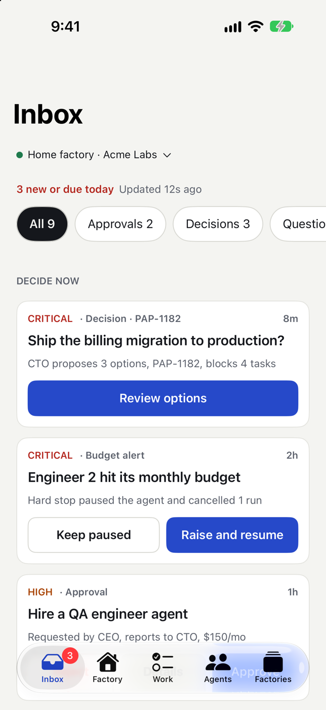
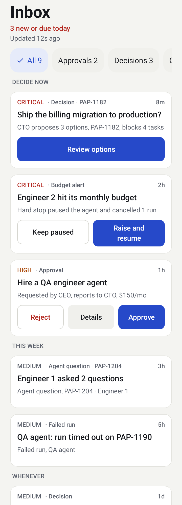

# Product summary

Paperclip runs a "factory" of AI agents. Agents propose; people decide. When the person who decides is away from their desk, the factory waits.

**Paperclip Agent Factory Mobile** puts the board operator's decisions, oversight and emergency controls in their pocket, for every Paperclip instance they run, without weakening the factory's security.

## What you can do

1. **Decide** what agents are waiting on: approvals, decisions, questions and budget stops, usually in two taps from a notification.
2. **Know** whether the factory is healthy: what is running, failing, blocked or overspending.
3. **Intervene** safely: pause an agent, cancel a run, redirect work with a comment, each behind Face ID or a fingerprint when it is destructive.

You can connect several Paperclip instances ("factories") and switch between them and between companies. Setting up and managing those connections is part of the app. Configuring agents and administering the instance stays in the Paperclip web app.

## Who it is for

The owner or operator of one or more Paperclip instances, at home or in the cloud, away from the web app.

## Platforms

iPhone (iOS 17 and later) and Android (9 and later, phones). Both use one shared Kotlin core, so they behave the same; each follows its own platform's look and conventions. On Android the "are you the owner of this phone" check is the system prompt for a fingerprint, face or screen lock.

## Where it stands

- **Built and tested:** the shared Kotlin core and the whole of both apps, iPhone and Android: setting up and managing factories, the Inbox, decisions, approvals, budget incidents, Factory home, agents and runs, issues and their interaction forms, settings and app lock. They enforce roles, ask for the device owner (Face ID, fingerprint or screen lock) before destructive actions, never retry a change, keep working from their last data when offline, and support large text, dark mode, screen-reader labels, reduced motion and large touch targets.
- **Runs on demo data:** every screen works end to end on a built-in demo factory (no server), in debug builds and in the Android `releaseDemo` build.
- **Not built:** notifications (Phase 3), scanning a QR code or opening a link to add a factory, opening an issue's attachments in the app, and formatted (markdown) comments on Android.
- **Not yet proven:** the connection to a real Paperclip server and key storage in the Keychain and the Android Keystore are built and tested against fakes, a stubbed server and an emulator, but no pairing from either app against a live server has been run. On Android, the system prompt with a real enrolled fingerprint, new-fingerprint invalidation, scroll smoothness on a real phone and a screen reader pass have not been done.

So the apps cannot yet be said to manage a real factory; they can be built, run and tried on the demo factory. See [user-docs/getting-started.md](../user-docs/getting-started.md) and [product-details.md](./product-details.md).

 
