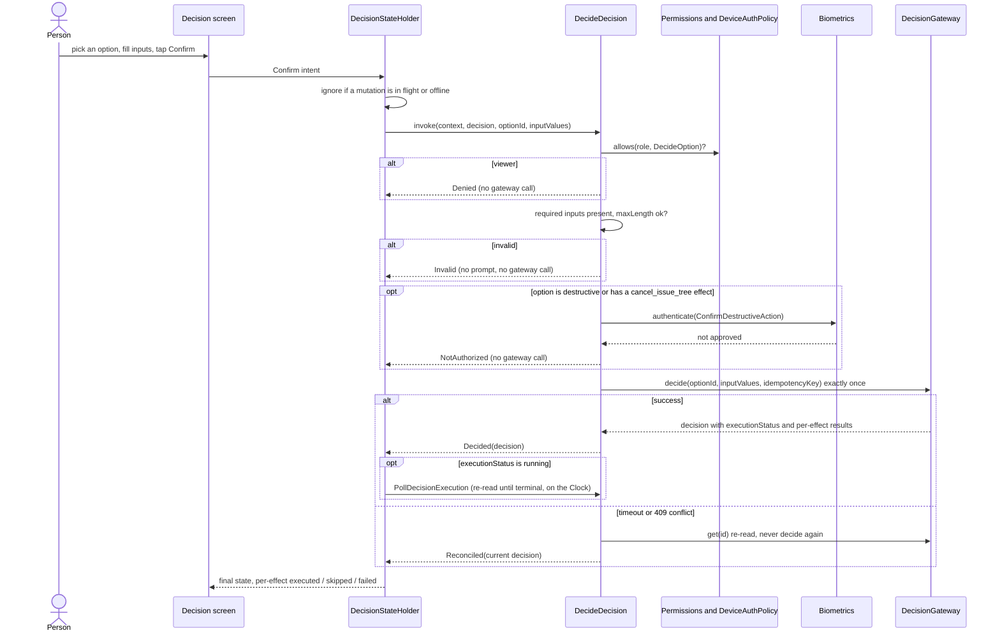
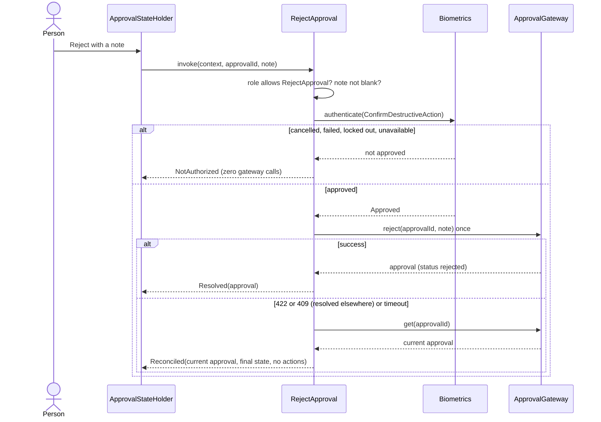
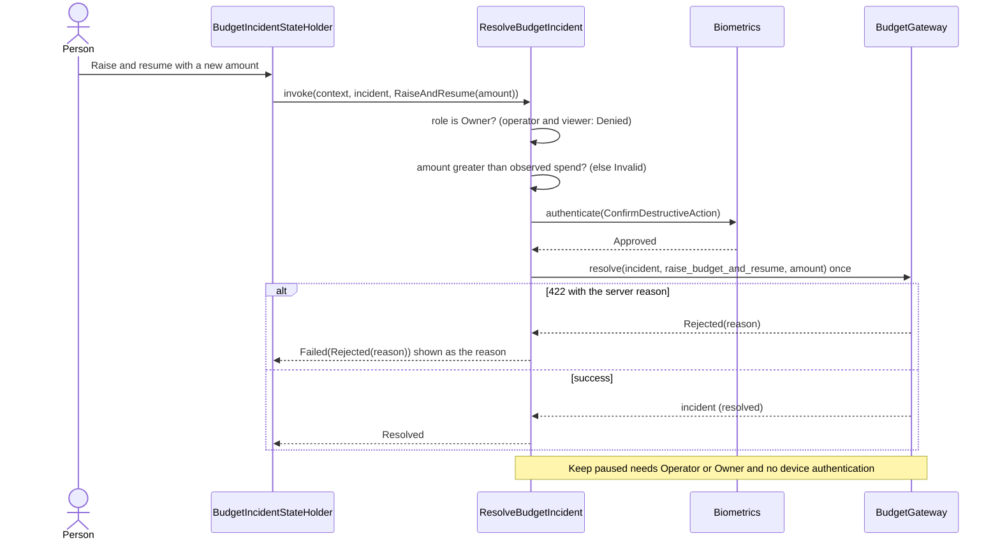
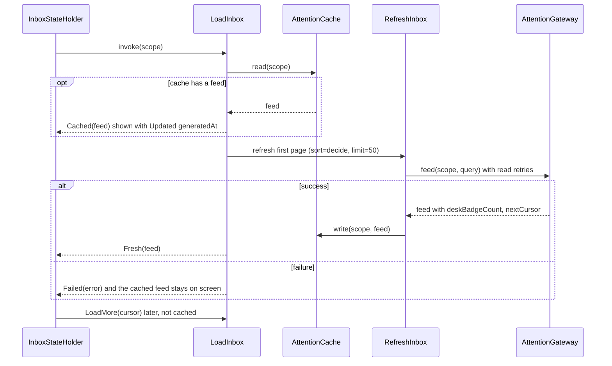

# Architecture: Phase 1a shared contracts

**Date:** 2026-11-01 · **Status:** Draft

## Architecture overview

Unchanged from [the parent plan](../../261101-iphone-app/plan.md) section 3: presentation, application and domain in shared Kotlin; infrastructure implements domain ports; the umbrella wires them; apps render state. This phase adds the contents of the three inner layers and the fakes.

## Component architecture

- **Domain:** entities, value objects, ports, `DomainError`, `Role`, `Permissions`, `DeviceAuthPolicy`.
- **Application:** use cases grouped by feature package: `instance`, `auth`, `attention`, `decision`, `approval`, `budget`, `issue`, `agent`, `run`, `dashboard`, `refresh`.
- **Presentation:** one state holder per screen, each with `state: StateFlow<XState>` and `onIntent(XIntent)`.
- **Testing:** `fakes/` (one per port), `fixtures/`, `DemoData`, `contract/` (abstract test suites).
- **Umbrella:** `PaperclipCore.createGraph(mode)` builds a live or demo graph; the demo graph is all fakes.

## Layer responsibilities

| Layer | Owns | Never |
|---|---|---|
| Domain | what things are, what is allowed (roles, auth policy) | I/O, JSON, time except via `Clock` |
| Application | one action, its preconditions and sequencing across ports | UI wording, platform types |
| Presentation | what is enabled, confirmed, shown, and error keys | platform widgets, strings |

## Data flow

Intent -> state holder -> use case -> port (fake now, adapter in 1b) -> result -> state update. Reads render cached data first (FR-095), then refresh.

## Sequence diagrams

Slice 1a-2 (attention, decisions, approvals, budget incidents). Pause agent and polling refresh are drawn with slice 1a-3.

### 1. Decide a decision

### 2. Resolve an approval with device authentication

Approve and Comment skip the Biometrics step (not in `DeviceAuthPolicy`); Request revision needs a note and `pending` status.

### 3. Resolve a budget incident

### 4. Inbox load, cache first then refresh

## Integration points

Ports listed in the data dictionary. Phase 1b implements them; contract suites make "the fake and the real adapter agree" a test.

## Architectural decisions

Recorded in `docs/architectural-decision-record.md` as they are made. Decided now: (1) sealed `Unsupported` branches for unknown server kinds; (2) device authentication is enforced inside the use case through the `Biometrics` port, never in the UI; (3) state holders take an injected `CoroutineScope` and a `Clock`, run use cases in that scope, and cancel it from a `close()` that the platform calls when the screen goes away; (4) `Secret.reveal()` is callable only from the API auth plugin, enforced by a Konsist rule. Sequence diagrams for slice 1a-2 are above; pause agent and polling refresh follow with slice 1a-3. Slice 1a-2 decisions: ADR-015 to ADR-020.
