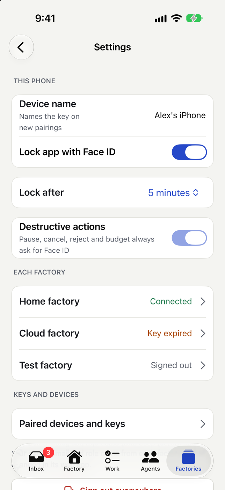
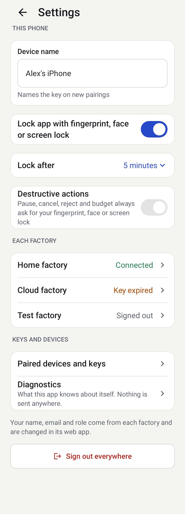
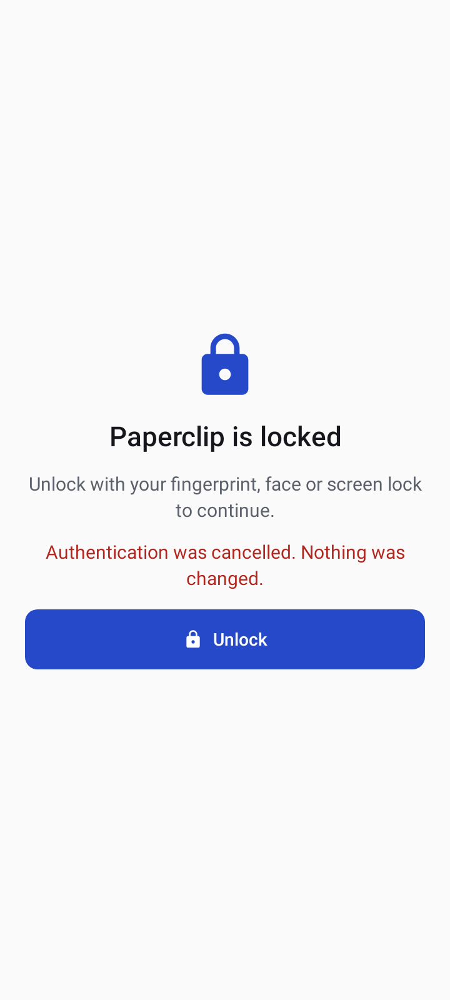

# App lock and security settings

Settings (from the Factories tab) controls this phone.

- **Lock app with Face ID** locks the app when you leave it for longer than **Lock after** (immediately, or from one minute up to an hour or more). The app switcher shows a blurred screen.
- **Destructive actions** (pause an agent, cancel a run, reject an approval, a destructive decision option, raise a budget, remove a factory) always ask for Face ID, a fingerprint or your passcode first. This cannot be turned off. A lock icon marks these buttons. If you cancel the prompt, nothing is sent.
- **Device name** names the key on new pairings.
- **Paired devices and keys** lists the keys of each factory; **Sign out** keeps the factory in the list, **Sign out everywhere** also revokes the keys.

## On Android

- **Lock app with fingerprint, face or screen lock** is the same switch. The system prompt accepts a fingerprint or face, or your PIN, pattern or password. On Android 9 and 10 the prompt takes weak biometrics or your screen lock; on 11 and later strong biometrics or your screen lock.
- **Lock after** works as described above; the lock screen has one **Unlock** button. Cancelling leaves the app locked and nothing changes.
- **Destructive actions** show the app's confirmation sheet with a lock icon, then the system prompt. If you cancel, fail, are locked out of biometrics for a while, or the phone has no fingerprint, face or screen lock set up, nothing is sent. This includes **raising an agent's monthly budget** (or setting it to zero): the Save button carries the lock icon and its spoken name says it asks you; lowering a budget asks nothing.
- **With the app lock on, the system may ask more than once.** The app lock makes the key that talks to the factory a protected one, and each read of it is its own fingerprint or screen-lock check; a refresh that makes several requests can ask several times, and an unlock a moment earlier, or another app's check, never counts. How often it asks has not been measured, and how to reduce it (one check per refresh, or a short in-memory key while the app is open) is a decision for the owner that has not been taken ([ADR-144](../docs/architectural-decision-record.md#adr-144-with-app-lock-on-how-often-may-a-refresh-ask-for-the-fingerprint-open-owner-decision-not-implemented)). If it is too much, leave the lock switch off; destructive actions still always ask.
- **Recents.** While the app is locked, and while a pairing page is open, the app's thumbnail in the recent apps list is blank, and screenshots are blocked.
- **No screen lock, no app.** If you remove the phone's screen lock, Android deletes the keys that depend on it. The factory then needs [re-pairing](./key-expiry-and-repairing.md). The same happens when new fingerprints are enrolled on some phones; this behaviour has been checked in tests but not yet with a real fingerprint enrolment.
- The **Diagnostics** screen (Settings) shows what the app knows about itself (app version, server compatibility, whether the app's data opened, the last key-storage error class, the last device-prompt result and the last pairing outcome), with any address or key removed. You can copy the report; nothing is ever sent anywhere.
