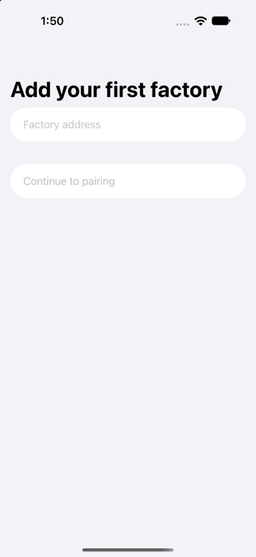

# Adding your first factory

A **factory** is one Paperclip server. The app asks for its address first.

1. Type or paste the address, for example `https://paperclip.example.com`.
2. The app checks it as you type. If something is wrong it says what to change:
   - **Start the address with https://** — the address needs a secure scheme.
   - **Use a secure https:// address** — plain `http://` is refused (only `localhost` is allowed in test builds).
   - **Remove the user name and password** or **Remove everything after the server address** — keep only the server address and an optional path.
3. When the address is valid the app shows the cleaned-up address it will connect to and enables **Continue to pairing**.

Pairing itself (approving this phone in your browser and storing the access key in the Keychain) is not built yet.

**Private servers.** If your Paperclip runs at home, the phone must be able to reach it, for example through Tailscale. The app only connects to servers in `authenticated` mode; a server in `local_trusted` mode is refused.
