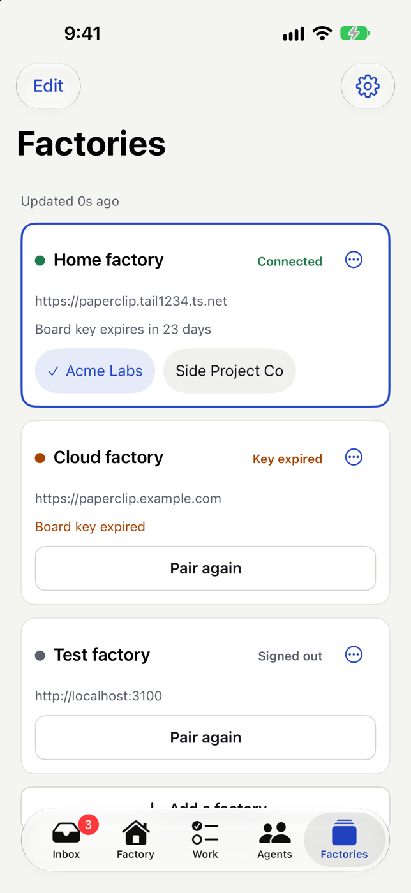
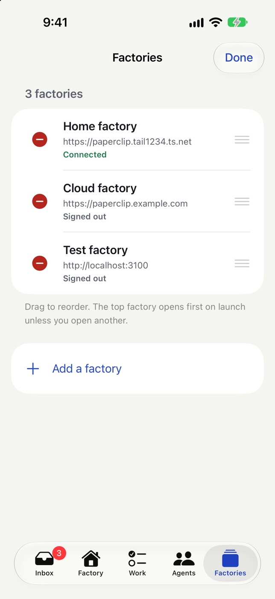
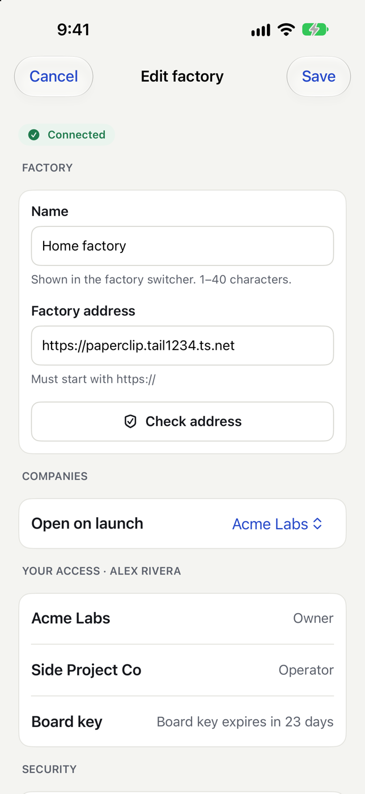
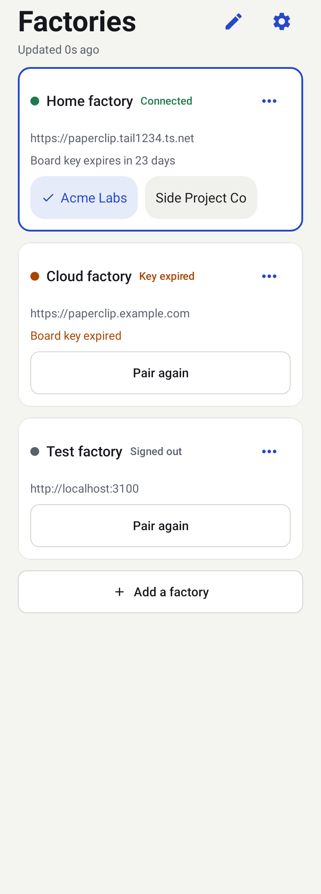
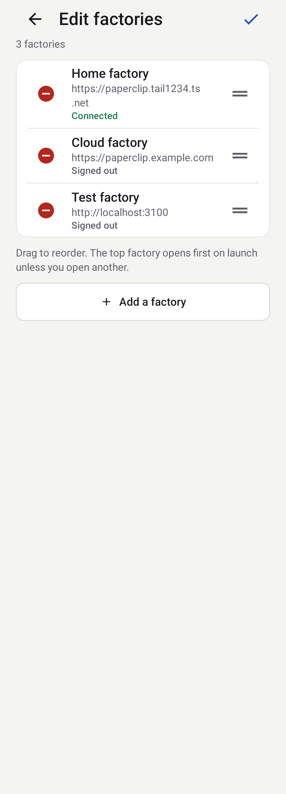
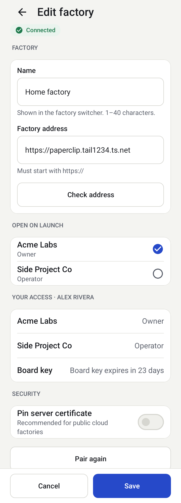
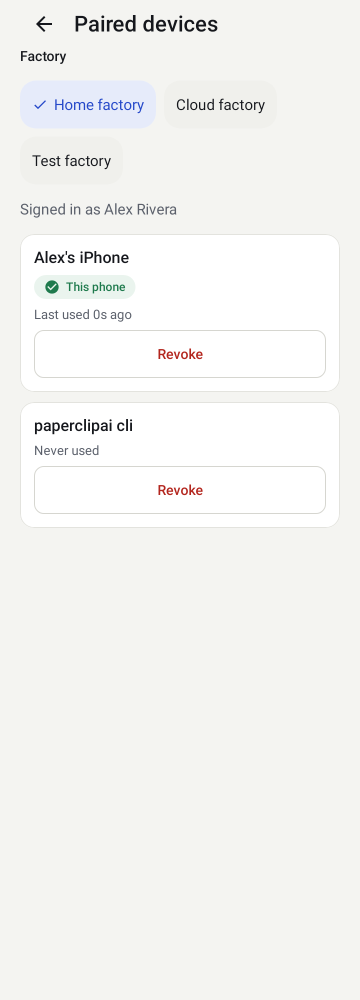

# Adding and managing factories

You can connect several factories and companies; every screen works across them. The **Factories** tab lists each factory with its status (Connected, Key expired, Signed out), when its board key expires and a chip per company.

- Tap a company chip to make it the current one; the factory switcher at the top of Inbox, Factory, Work and Agents does the same.
- **Manage** lets you reorder, edit, re-pair or remove factories. Removing needs Face ID.

- **Edit** changes the name and address (checked again), the company opened on launch, and shows your role per company and the key expiry.

The app never edits your server profile; that stays in the web app.

## On Android

The Factories tab, **Manage**, **Edit** and Settings work as above, with these differences:

- **Reorder** in Manage by pressing and dragging the handle on the right. With TalkBack on, each row also offers "Move up" and "Move down" actions.
- **Remove** asks for the confirmation sheet and then your fingerprint, face or screen lock.
- If the app cannot save a new order it shows the saved order again and says "The order could not be saved. Try again."
- Switching to another factory or company returns every tab to its first screen, so you never see a screen of the old factory under the new one.
- The factory's top-bar actions are a pencil (Manage) and a gear (Settings). **Add a factory** is at the bottom of the list.

**Paired devices and keys** (Settings) lists each key of the selected factory with when it was last used and a **Revoke** button; the row for this phone says "This phone".

